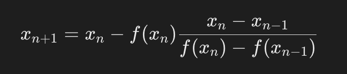
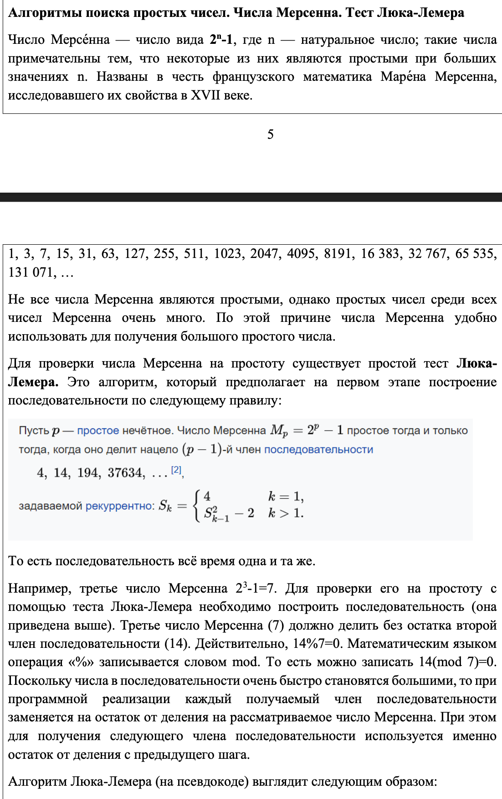
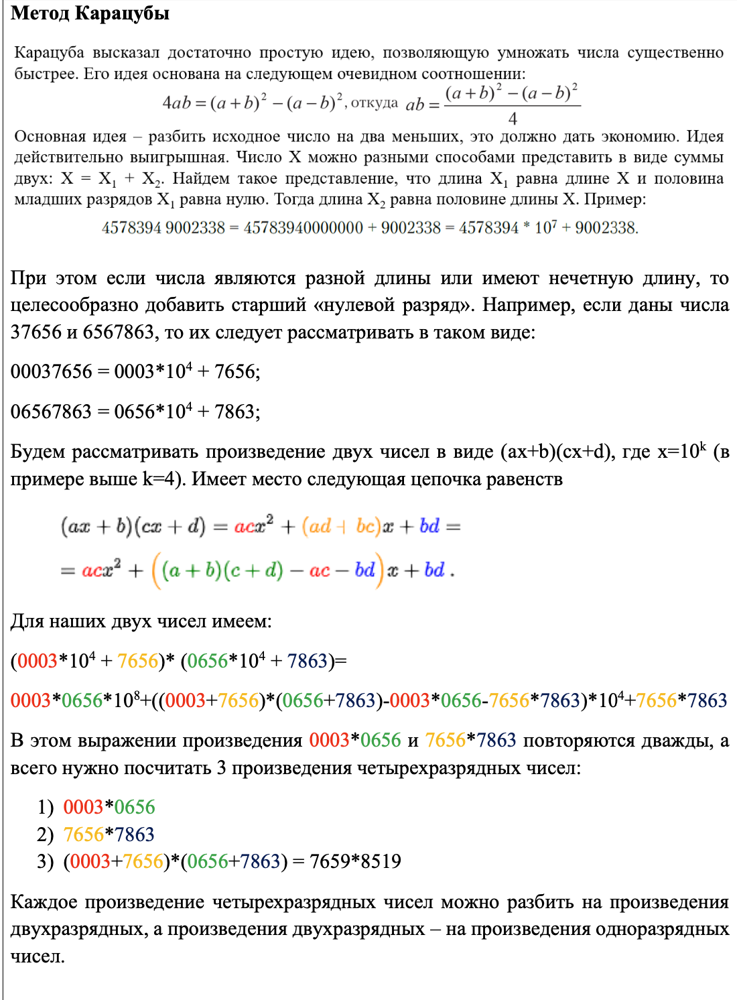
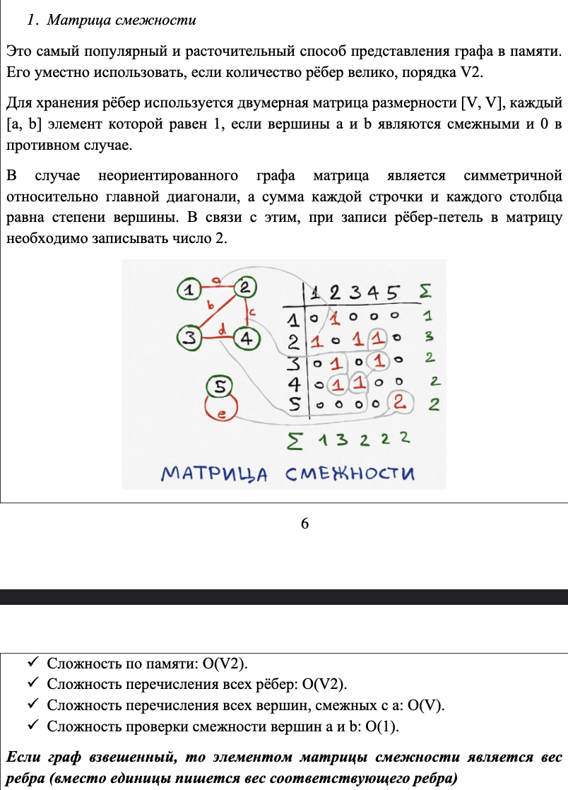
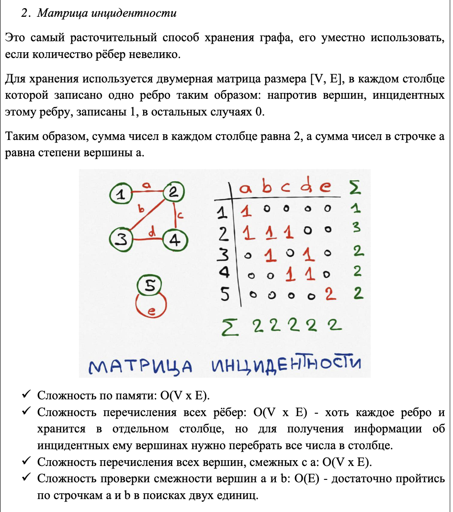

# Вопросы из СДО

## 1 Понятие алгоритма

### Краткий ответ

Алгоритм – это последовательность шагов, предназначенная для решения конкретной задачи или достижения цели.

### Развернутый ответ

Алгоритм – это чётко определённый и конечный набор инструкций, которые описывают порядок действий для выполнения определённой задачи. Алгоритмы широко применяются в математике, компьютерных науках и различных областях инженерии. Они могут быть выражены на естественном языке, через блок-схемы, псевдокод или в виде программного кода. Основные характеристики алгоритмов включают конечность, детерминированность, понятность и эффективность.

## 2 Основные свойства алгоритма

* Дискретность: Алгоритм состоит из отдельных шагов.
* Понятность:  Каждый шаг должен быть понятен исполнителю (компьютеру).
* Определённость:  Результат каждого шага однозначно определяется.
* Результативность: Алгоритм должен приводить к результату за конечное число шагов.
* Массовость: Алгоритм должен быть применим для решения целого класса задач.

## 3 Способы описания алгоритма

* Словесный:  Обычный текст, как рецепт.
* Графический: Блок-схемы, где каждый блок - это действие.
* Программный: На языке программирования, понятном  компьютеру.

## 4 Линейные алгоритмы

### Краткий ответ

Линейные алгоритмы выполняются последовательно, шаг за шагом, без ветвлений и циклов.

### Развернутый ответ

Линейные алгоритмы представляют собой последовательность шагов, которые выполняются один за другим в строго определённом порядке. В таких алгоритмах отсутствуют условия (ветвления) и циклы (повторения шагов), что делает их выполнение прямолинейным и предсказуемым. Каждый шаг выполняется точно один раз, и после его завершения алгоритм переходит к следующему шагу.

Примеры линейных алгоритмов включают:

* Вычисление суммы двух чисел.
* Последовательное выполнение нескольких арифметических операций.

Линейные алгоритмы просты в реализации и анализе, но их область применения ограничена задачами, которые можно решить без необходимости повторения шагов или проверки условий.

### Пример

```python
a = (2 + 5) * 3
print(a)
```

## 5 Ветвящиеся алгоритмы

### Краткий ответ

Ветвящиеся алгоритмы включают условия, по которым выполнение алгоритма может пойти по разным путям.

### Развернутый ответ

Ветвящиеся алгоритмы содержат условия (логические выражения), в зависимости от выполнения которых выбирается один из нескольких возможных путей дальнейшего выполнения. Такие алгоритмы позволяют принимать решения в процессе выполнения, что делает их более гибкими и способными обрабатывать более сложные задачи по сравнению с линейными алгоритмами.

Основные элементы ветвящихся алгоритмов:

* **Условные операторы**: позволяют проверять условия и выбирать путь выполнения. Примеры: `if-else` в большинстве языков программирования.
* **Множественный выбор**: использование конструкции `switch-case` или аналогов для выбора одного из нескольких возможных вариантов на основе значения переменной.

Такие алгоритмы часто применяются в задачах, где необходимо проверять различные условия и принимать решения в зависимости от их выполнения. Например, проверка ввода пользователя и выполнение соответствующих действий в зависимости от введённых данных.

### Пример

```python
age = 18
if age < 18:
    print("Вам меньше 18 лет")
else:
    print("Вам 18 лет или больше")
```

## 6 Циклические алгоритмы

### Краткий ответ

Циклические алгоритмы выполняют определённые действия многократно, пока выполняется заданное условие.

### Развернутый ответ

Циклические алгоритмы включают повторяющиеся действия, которые выполняются до тех пор, пока соблюдается определённое условие. Эти алгоритмы используют циклы для многократного выполнения набора инструкций, что позволяет эффективно обрабатывать большие объемы данных или выполнять повторяющиеся задачи.

Основные виды циклов:

* **Цикл с предусловием (`while`)**: выполняется, пока условие истинно.
* **Цикл с постусловием (`do-while`)**: сначала выполняется тело цикла, затем проверяется условие.
* **Цикл с счётчиком (`for`)**: выполняется определённое количество раз.

Циклические алгоритмы позволяют:

1. Обрабатывать массивы и списки.
2. Выполнять действия, зависящие от многократного выполнения одинаковых операций.
3. Реализовывать сложные вычислительные задачи, требующие повторения шагов.

Эти алгоритмы широко используются в программировании и алгоритмике благодаря своей способности обрабатывать данные и выполнять повторяющиеся действия эффективно и структурированно.

### Пример

Сумма элементов

```python
summa = 0
while summa != 23:
    summa += 1
print(summa)
```

Поиск индекса элемента в массиве

```python
array = [1, 3, 5, 2, 6]
for index in range(len(array)):
    if array[index] == 2:
        print(index)
        break
```

## 7 Решение уравнения методом деления отрезка пополам

### Краткий ответ

Метод деления отрезка пополам (метод бисекции) заключается в итеративном делении отрезка пополам и выборе подотрезка, на котором функция меняет знак, до достижения нужной точности.

### Развернутый ответ

Метод деления отрезка пополам, или метод бисекции, используется для нахождения корней уравнения *f(x) = 0* на заданном отрезке *[a, b]*, где функция *f* непрерывна и знаки значений функции на концах отрезка различны (т.е. *f(a) * f(b) < 0*). Метод заключается в следующем:

1. **Проверка условия начального отрезка**: Убедиться, что *f(a) * f(b) < 0*. Если это условие не выполняется, метод не применим на данном отрезке.
2. **Итеративное деление отрезка**:
    * Найти середину отрезка: *c = (a + b)/2*.
    * Вычислить значение функции в середине: *f(c)*.
    * Если *f(c) = 0*, то *c* и есть корень уравнения.
    * Если *f(a) * f(c) < 0*, то корень находится в отрезке *[a, c]*, иначе в отрезке *[c, b]*.
3. **Сужение отрезка**: Заменить отрезок *[a, b]* на подотрезок, в котором функция меняет знак.
4. **Повторение шагов**: Повторять шаги 2 и 3, пока длина отрезка не станет меньше заданной точности.
5. **Результат**: Середина отрезка в последней итерации будет приближением к корню уравнения с заданной точностью.

Этот метод гарантирует нахождение корня при условии, что функция непрерывна и значения на концах отрезка имеют противоположные знаки. Метод эффективен и прост в реализации, но может быть медленным по сравнению с другими методами, такими как метод Ньютона, если требуется высокая точность.

### Пример

```python
def bisection_method(f, a, b, epsilon):
    if f(a) * f(b) >= 0:
        print("f(a) и f(b) должны иметь разные знаки")
        return
    
    while (b - a) / 2 > epsilon:
        c = (a + b) / 2
        if f(c) == 0:
            return c
        elif f(a) * f(c) < 0:
            b = c
        else:
            a = c
    
    return (a + b) / 2

# Пример функции
def f(x):
    return x**3 - x - 2

# Найти корень на отрезке [1, 2] с точностью 0.01
root = bisection_method(f, 1, 2, 0.01)
print("Корень:", root)
```

## 8 Решение уравнения методом касательных

### Краткий ответ

Метод касательных (метод Ньютона) использует итерации с помощью касательных к функции для приближения к корню уравнения.

### Развернутый ответ

Метод касательных, или метод Ньютона, решает уравнение *f(x) = 0* путём итеративного приближения к корню с использованием касательных к графику функции. Этот метод требует начального приближения *x_0* и производной функции *f'(x)*. Алгоритм заключается в следующем:

1. **Начальное приближение**: Выбирается начальное приближение *x_0*.
2. **Итерации**:
    * Вычисляется значение функции *f(x_n)* и её производной *f'(x_n)* в текущей точке *x_n*.
    * Вычисляется новое приближение по формуле: *x_{n+1} = x_n - f(x_n)/f'(x_n)*.
    * Проверяется условие остановки: если разница между *x_{n+1}* и *x_n* меньше заданной точности, итерации прекращаются.
3. **Результат**: Последнее вычисленное значение *x_{n+1}* считается приближением к корню уравнения.

Этот метод требует, чтобы начальное приближение было достаточно близко к истинному корню, а функция *f(x)* и её производная *f'(x)* были непрерывны и не равны нулю в области итераций. Метод Ньютона часто сходится очень быстро, особенно если начальное приближение близко к реальному корню. Однако, если производная равна нулю или начальное приближение далеко от корня, метод может не сработать.

### Пример

```python
def newton_method(f, df, x0, epsilon):
    x_n = x0
    while True:
        f_x_n = f(x_n)
        df_x_n = df(x_n)
        if df_x_n == 0:
            print("Производная равна нулю, метод Ньютона не применим")
            return
        
        x_n1 = x_n - f_x_n / df_x_n
        
        if abs(x_n1 - x_n) < epsilon:
            return x_n1
        
        x_n = x_n1

# Пример функции и её производной
def f(x):
    return x**3 - x - 2

def df(x):
    return 3*x**2 - 1

# Начальное приближение x0 и точность epsilon
x0 = 1.5
epsilon = 0.0001

# Найти корень
root = newton_method(f, df, x0, epsilon)
print("Корень:", root)
```

## 9 Решение уравнения методом хорд

### Краткий ответ

Метод хорд (метод секущих) использует итеративный процесс, в котором вычисляются пересечения хорд с осью абсцисс для приближения корня уравнения.

### Развернутый ответ

Метод хорд, или метод секущих, является численным методом для нахождения корня уравнения *f(x) = 0*. В отличие от метода Ньютона, он не требует вычисления производной функции. Вместо этого метод использует две начальные точки и итеративно приближает корень, используя хордовые отрезки.

Алгоритм метода хорд состоит из следующих шагов:

1. **Выбор начальных приближений**: Выбираются две начальные точки *x_0* и *x_1* так, чтобы *f(x_0) \neq f(x_1)*.
2. **Итеративный процесс**:
    * Вычисляется новое приближение *x_{n+1}* по формуле:
      
    * Проверяется условие остановки: если *|x_{n+1} - x_n| < epsilon*, где *epsilon* — заданная точность, итерации прекращаются.
3. **Результат**: Последнее вычисленное значение *x_{n+1}* считается приближением к корню уравнения.

Метод хорд является эффективным численным методом, особенно когда производная функции недоступна или трудна для вычисления. Он часто требует больше итераций по сравнению с методом Ньютона, но в некоторых случаях может быть более удобным и применимым. Этот метод подходит для функций, где значения в начальных точках *x_0* и *x_1* не равны и обеспечивают приближение к корню.

### Пример

```python
def secant_method(f, x0, x1, epsilon):
    f_x0 = f(x0)
    f_x1 = f(x1)
    
    if f_x0 == f_x1:
        raise ValueError("Значения функции в начальных точках не должны быть равны")

    while abs(x1 - x0) >= epsilon:
        x2 = x1 - f_x1 * (x1 - x0) / (f_x1 - f_x0)
        x0, x1 = x1, x2
        f_x0, f_x1 = f_x1, f(x1)
    
    return x1

# Пример функции
def f(x):
    return x**3 - x - 2

# Начальные приближения x0 и x1 и точность epsilon
x0 = 1
x1 = 2
epsilon = 0.0001

# Найти корень
root = secant_method(f, x0, x1, epsilon)
print("Корень:", root)
```

## 10 Метод наименьших квадратов. Регрессия

### Краткий ответ

Метод наименьших квадратов минимизирует сумму квадратов отклонений между наблюдаемыми значениями и предсказанными, чтобы определить наилучшие параметры модели.

### Развернутый ответ

Метод наименьших квадратов — это статистический метод, используемый для нахождения наилучшего приближения зависимости между зависимой переменной и одной или несколькими независимыми переменными. Этот метод минимизирует сумму квадратов отклонений наблюдаемых значений от предсказанных значений модели.

Метод наименьших квадратов является основой многих более сложных методов регрессии и широко применяется в статистике и машинном обучении для анализа и предсказания данных.

## 11 Алгоритм Евклида для поиска наибольшего общего делителя (НОД)

### Краткий ответ

Алгоритм Евклида — это эффективный метод для нахождения наибольшего общего делителя двух целых чисел.

### Развернутый ответ

Алгоритм Евклида предназначен для нахождения наибольшего общего делителя (НОД) двух целых чисел *a* и *b*. НОД двух чисел — это наибольшее число, на которое делятся оба числа без остатка.

### Шаги алгоритма Евклида

1. **Исходные числа**: Пусть *a* и *b* — два целых числа, для которых мы ищем НОД.
2. **Основной шаг**: Пока *b != 0*:
   * Вычисляем остаток от деления *a* на *b*: *r = a \mod b*.
   * Обновляем значения: *a = b* и *b = r*.
3. **Результат**: Когда *b = 0*, значение *a* будет наибольшим общим делителем чисел *a* и *b*.

### Сложность и эффективность

Алгоритм Евклида имеет линейную сложность *O(log(min(a, b)))*, что делает его очень эффективным для вычисления НОД даже для очень больших чисел. Он является одним из базовых алгоритмов в арифметике и используется в различных областях, включая криптографию и математические расчеты.

### Пример

```python
def gcd(a, b):
    while b != 0:
        a, b = b, a % b
    return a

# Пример использования
num1 = 36
num2 = 60
result = gcd(num1, num2)
print("Наибольший общий делитель чисел", num1, "и", num2, ":", result)
```

## 12 Понятие о факторизации числа

### Краткий ответ

Факторизация числа — это процесс разложения числа на простые множители.

### Развернутый ответ

Факторизация числа представляет собой математический процесс, в результате которого число разлагается на простые множители. Простые числа являются числами, которые имеют ровно два различных положительных делителя: единицу и само число. Факторизация чисел является важной задачей в математике и криптографии.

Факторизация чисел имеет большое значение в криптографии, где сложность факторизации больших чисел используется для создания надёжных криптографических алгоритмов, таких как RSA. Также факторизация играет важную роль в алгоритмах решения уравнений, кодировании данных и других областях математики и информатики.

## 13 Алгоритм Ферма факторизации

### Краткий ответ

Алгоритм Ферма факторизации — это метод для разложения составного числа на множители, основанный на предположении, что составное число может быть представлено в виде разности квадратов.

### Развернутый ответ

Алгоритм Ферма факторизации был разработан итальянским математиком Пьерре де Ферма в XVII веке. Он является одним из старейших известных методов факторизации чисел и предполагает, что любое нечётное составное число *n* может быть представлено в виде разности квадратов:
*n = a^2 - b^2 = (a - b)(a + b)*

### Шаги алгоритма Ферма

1. **Выбор начальных значений**: Выбираются целые числа *a* и *b*, такие что *a^2 >= n*.
2. **Проверка условия квадратности**: Вычисляется *x = sqrt(a^2 - n)*. Если *x* является целым числом, то *n* уже является квадратом, и факторизация завершается.
3. **Итерационный процесс**:
   * Увеличиваем *a* и проверяем, если *a^2 >= n*, то уменьшаем *b*.
   * Проверяем, является ли *a^2 - b^2* квадратом.
   * Если находим такие *a* и *b*, что *a^2 - b^2* является квадратом, то разлагаем *n* на множители как *n = (a - b)(a + b)*.
4. **Остановка**: Процесс продолжается до тех пор, пока не будет найдено разложение числа *n* на множители.

### Пример

```python
import math

def fermat_factorization(n):
    x = int(n ** 0.5) + 1
    while not math.sqrt(x * x - n):
        x += 1
    
    y = int((x * x - n) ** 0.5)
    a = x - y
    b = x + y
    return a, b

# Пример использования
n = 8051
p, q = fermat_factorization(n)
print(f"Число {n} разложено на множители: {p} и {q}")
```

## 14 Алгоритмы поиска простых чисел. Решето Эратосфена

### Краткий ответ

Решето Эратосфена — это алгоритм для эффективного поиска всех простых чисел до заданного числа *n*.

### Развернутый ответ

Решето Эратосфена — это алгоритм для нахождения всех простых чисел до заданного числа *n*. Он был разработан древнегреческим математиком Эратосфеном около 240 года до н. э. и остаётся одним из самых эффективных способов нахождения простых чисел.

### Шаги алгоритма Решето Эратосфена

1. **Инициализация**: Создаётся список чисел от 2 до *n*. В начале считаем, что все числа являются простыми.
2. **Обход списка**: Начиная с первого числа *p = 2*: Если число *p* не помечено как не простое (т.е. простое), помечаем все его кратные числа (кроме самого числа *p*) как не простые.
3. **Переход к следующему простому числу**: Переходим к следующему числу в списке, которое ещё не было помечено как не простое.
4. **Остановка**: Процесс продолжается до тех пор, пока не будут рассмотрены все числа до *sqrt(n)*. Все числа, которые остались помеченными как простые, являются простыми числами.

### Пример

```python
def sieve_of_eratosthenes(n):
    # Создаём список для хранения информации о простоте чисел
    is_prime = [True] * (n + 1)
    is_prime[0] = is_prime[1] = False  # 0 и 1 не являются простыми числами
    
    p = 2
    while (p * p <= n):
        if (is_prime[p] == True):
            # Помечаем все кратные p как не простые числа
            for i in range(p * p, n + 1, p):
                is_prime[i] = False
        p += 1
    
    # Собираем список всех простых чисел до n
    primes = [p for p in range(n + 1) if is_prime[p]]
    return primes

# Пример использования
n = 30
primes = sieve_of_eratosthenes(n)
print(f"Простые числа до {n}: {primes}")
```

### Значение и применение

Решето Эратосфена широко используется в задачах, требующих быстрого нахождения простых чисел, таких как криптография, оптимизация алгоритмов и математические расчёты. Он является классическим примером эффективного алгоритма для работы с большими наборами чисел.

## 15 Числа Мерсенна. Тест Люка-Лемера



## 16 Псевдослучайные числа

Числа фон Неймана (von Neumann numbers) — это один из первых методов генерации псевдослучайных чисел, предложенный учёным Джоном фон Нейманом во второй половине XX века. Основная идея метода заключается в том, чтобы использовать физический процесс, который теоретически обладает случайной природой, для генерации случайных чисел.

### Принцип работы метода

1. **Физический процесс**: В основе метода фон Неймана лежит использование физических процессов, которые считаются случайными в классическом понимании. Например, это могут быть шумы в электрических цепях, тепловое движение атомов и молекул (так называемый тепловой шум), колебания цен на финансовых рынках и т.д.

2. **Преобразование в случайные числа**: Полученные данные из физического процесса (например, последовательность случайных чисел) подвергаются специальной обработке, которая приводит их к форме псевдослучайных чисел.

3. **Использование алгоритмов**: Полученные числа могут использоваться как исходные данные для дальнейших алгоритмов, которые обеспечивают равномерное распределение и большой период.

### Пример алгоритма

Приведу пример простого алгоритма, демонстрирующего принцип работы метода фон Неймана:

1. Зафиксируем два показания часов.
2. Сложим их.
3. Разделим сумму на 2 и возьмем остаток от деления.

## 17 Метод Карацубы для быстрого умножения двух чисел

Метод Карацубы — это алгоритм для быстрого умножения двух больших чисел, который основывается на принципе декомпозиции чисел на более мелкие части и рекурсивного использования умножения. Этот метод позволяет значительно уменьшить количество элементарных операций по сравнению с классическим методом умножения.



## 18 Алгоритм быстрого возведения в степень

Алгоритм быстрого возведения в степень — это эффективный метод для вычисления степени числа *x* в целочисленной степени *n*. Он использует принцип разделяй и властвуй для уменьшения числа операций.

### Основные идеи алгоритма

1. **Разделяй и властвуй**: Вместо прямого умножения числа *x* на себя *n* раз, алгоритм разбивает вычисление степени на более мелкие подзадачи.
2. **Чётность степени *n***:
   * Если степень *n* чётная, то *x^n = (x^(n/2))^2*.
   * Если степень *n* нечётная, то *x^n = x * x^(n-1)*.
3. **Рекурсивное уменьшение степени**: Процесс повторяется до тех пор, пока степень *n* не станет равной нулю.

### Пример

```python
def power(x, n):
    if n == 0:
        return 1
    elif n == 1:
        return x
    elif n < 0:
        return 1 / power(x, -n)
    else:
        half_power = power(x, n // 2)
        if n % 2 == 0:
            return half_power * half_power
        else:
            return x * half_power * half_power

# Пример использования
x = 2
n = 10
print(f"{x} в степени {n} равно {power(x, n)}")
```

## 19 Понятие о рекурсии

Рекурсия — это концепция в программировании, при которой функция вызывает саму себя непосредственно или через цепочку вызовов. Это основной механизм во многих алгоритмах и структурах данных.

### Преимущества и недостатки

**Преимущества**:

* Простота и естественность для некоторых задач.
* Позволяет уменьшить размер и упростить код для определенных алгоритмов.
* Удобство для решения задач, которые естественно разбиваются на подзадачи.

**Недостатки**:

* Может привести к глубокой вложенности вызовов и использованию большого объема памяти.
* Неправильная реализация может привести к бесконечному циклу вызовов (бесконечная рекурсия).

Рекурсия является мощным инструментом в программировании, который позволяет элегантно решать множество задач, однако требует осторожности при реализации и понимании базовых и рекурсивных случаев для предотвращения потенциальных проблем с производительностью и памятью.

### Пример

Рассмотрим пример вычисления факториала с использованием рекурсии:

```python
def factorial(n):
    # Базовый случай
    if n == 0:
        return 1
    # Рекурсивный случай
    else:
        return n * factorial(n - 1)

# Пример использования
print(factorial(5))  # Output: 120
```

## 20 Числа Фибоначчи

Числа Фибоначчи — это последовательность чисел, где каждое следующее число равно сумме двух предыдущих. Обычно последовательность начинается с чисел 0 и 1.

## 21 Задача о Ханойской башне

Задача о Ханойской башне — это классическая головоломка, которая состоит в перемещении всех дисков с одного стержня на другой, используя третий стержень в качестве промежуточного, с условием, что на более крупный диск нельзя класть меньший.

## 22 Динамическое программирование

Динамическое программирование (DP) — это метод решения сложных задач путём разбиения их на более простые подзадачи и сохранения результатов этих подзадач для последующего использования.

### Основные принципы

1. **Разбиение задачи**: Исходная задача разбивается на несколько подзадач.
2. **Сохранение результатов**: Результаты каждой подзадачи сохраняются для последующего повторного использования.
3. **Комбинирование результатов**: Результаты подзадач комбинируются для получения решения исходной задачи.

## 23 Задача сортировки массива

Сортировка массива — это процесс упорядочивания элементов массива в определенном порядке, таком как по возрастанию или убыванию.

## 24 Алгоритм пузырьковой сортировки

Алгоритм пузырьковой сортировки (Bubble Sort) — это простой алгоритм сортировки, который проходит по списку несколько раз. На каждом проходе он сравнивает соседние элементы и меняет их местами, если они находятся в неправильном порядке. После каждого прохода наибольший элемент "всплывает" в конец списка, как пузырёк в воде, отсюда и название алгоритма.

### Краткое описание алгоритма

1. **Проходы по списку**: Начиная с начала списка, сравниваются два соседних элемента.
2. **Поменять местами, если нужно**: Если элементы стоят в неправильном порядке (меньший следует за большим), они меняются местами.
3. **Повторение проходов**: Этот процесс повторяется для всех элементов списка, пока не будет достигнут конец списка.
4. **Уменьшение диапазона**: После каждого прохода самый большой элемент "всплывает" в конец списка, поэтому на следующем проходе его можно не рассматривать.
5. **Оптимизация**: Если за проход не было ни одной перестановки, значит, список уже отсортирован, и алгоритм может завершить работу.

### Сложность

* В худшем случае (когда список отсортирован в обратном порядке) время выполнения пузырьковой сортировки составляет *O(n^2)*, где *n* — количество элементов в списке.
* В лучшем случае (когда список уже отсортирован или почти отсортирован) время выполнения может быть *O(n)*, но алгоритм все равно требует прохода по списку для проверки.
* Память: Алгоритм сортировки пузырьком выполняется "на месте" и требует только постоянной дополнительной памяти *O(1)*.

Хотя пузырьковая сортировка не является самым эффективным алгоритмом сортировки для больших массивов данных из-за своей квадратичной сложности, она легко понимается и реализуется, что делает её полезной для обучения и первоначальных прототипов.

## 25 Алгоритм сортировки вставками

Алгоритм сортировки вставками (Insertion Sort) — это простой алгоритм сортировки, который строит отсортированную последовательность по одному элементу за раз. На каждом шаге текущий элемент вставляется в упорядоченную часть списка (или массива) на своё правильное место.

### Описание алгоритма

1. **Начало с неупорядоченного списка**: Алгоритм начинает с первого элемента, предполагая, что он уже отсортирован (так как одноэлементный список считается упорядоченным).
2. **Вставка элементов**: Для каждого последующего элемента алгоритм сравнивает его со всеми предыдущими элементами в отсортированной части списка. Элементы, которые больше текущего, сдвигаются вправо, чтобы освободить место для вставки текущего элемента.
3. **Повторение**: Этот процесс продолжается до тех пор, пока все элементы не будут вставлены на свои места в отсортированной части списка.

### Сложность

* В худшем и среднем случае время выполнения пузырьковой сортировки составляет *O(n^2)*, где *n* — количество элементов в списке.
* В лучшем случае (когда список уже отсортирован) время выполнения может быть *O(n)*, так как вставка элементов происходит без перемещений.
* Память: Алгоритм сортировки вставками выполняется "на месте" и требует только постоянной дополнительной памяти *O(1)*.

### Заключение

Алгоритм сортировки вставками эффективен для небольших списков или уже частично упорядоченных данных, где его квадратичная сложность не слишком сказывается на производительности. Он легко реализуется и понимается, что делает его полезным инструментом в образовательных и прототипных задачах.

## 26 Алгоритм сортировки выбором

Алгоритм сортировки выбором (Selection Sort) — это простой алгоритм сортировки, который на каждом шаге выбирает минимальный (или максимальный) элемент из неотсортированной части списка и помещает его в конец отсортированной части.

### Описание алгоритма

1. **Начало с неотсортированного списка**: Алгоритм начинает с предположения, что весь список является неотсортированным.
2. **Поиск минимального элемента**: На каждом проходе алгоритм ищет минимальный элемент в неотсортированной части списка.
3. **Обмен с началом отсортированной части**: Минимальный элемент меняется местами с первым элементом неотсортированной части списка.
4. **Увеличение границы отсортированной части**: После каждого прохода граница отсортированной части списка увеличивается на один элемент.
5. **Повторение процесса**: Этот процесс повторяется до тех пор, пока не весь список не будет отсортирован.

### Сложность

* Всегда выполняет *O(n^2)* сравнений и *O(n)* обменов, где *n* — количество элементов в списке.
* В худшем, среднем и лучшем случае алгоритм имеет одинаковую временную сложность, так как всегда выполняет одинаковое количество операций.
* Память: Алгоритм сортировки выбором выполняется "на месте" и требует только постоянной дополнительной памяти *O(1)*.

### Заключение

Алгоритм сортировки выбором прост в реализации, но из-за своей квадратичной сложности он не является эффективным для сортировки больших массивов данных. Однако он может быть полезен в случаях, когда требуется простой и понятный алгоритм сортировки для небольших наборов данных или для обучающих целей.

## 27 Алгоритм шейкерной сортировки

Алгоритм шейкерной сортировки (Cocktail Sort), также известный как двунаправленная сортировка пузырьком, является модификацией классической сортировки пузырьком. Он обеспечивает улучшение производительности путем уменьшения количества проходов по списку в сравнении с обычной сортировкой пузырьком.

### Описание алгоритма

1. **Проходы по списку**: Алгоритм начинает сначала списка и двигается вперед, как в сортировке пузырьком, сравнивая соседние элементы и меняя их местами, если они находятся в неправильном порядке.
2. **Обратное движение**: После завершения прохода от начала до конца списка, алгоритм начинает движение в обратном направлении от конца списка к началу, снова сравнивая и меняя элементы при необходимости.
3. **Оптимизация**: При каждом проходе вперед и назад самый большой (или самый маленький, в зависимости от направления сортировки) элемент "всплывает" в конец (или начало) списка, что уменьшает количество элементов, которые нужно рассматривать на следующем проходе.
4. **Условие завершения**: Алгоритм завершает работу, когда на каком-то проходе не было ни одной перестановки, что означает, что список уже отсортирован.

### Сложность

* В среднем и в худшем случае время выполнения шейкерной сортировки составляет *O(n^2)*, где *n* — количество элементов в списке.
* В лучшем случае (когда список уже отсортирован) время выполнения может быть *O(n)*, так как алгоритм может завершиться после первого прохода.
* Память: Алгоритм шейкерной сортировки выполняется "на месте" и требует только постоянной дополнительной памяти *O(1)*.

### Заключение

Шейкерная сортировка является улучшенной версией классической сортировки пузырьком, которая позволяет уменьшить количество проходов по списку и улучшить производительность на практике. Однако она все еще не является наилучшим выбором для сортировки больших массивов данных из-за своей квадратичной сложности.

## 28 Алгоритм сортировки Шелла

Алгоритм сортировки Шелла (Shell Sort) является усовершенствованным алгоритмом вставочной сортировки, который применяет сортировку вставками к группам элементов с некоторым шагом (gap), который уменьшается на каждом проходе. Этот алгоритм придуман Дональдом Шеллом в 1959 году и является одним из первых "быстрых" алгоритмов сортировки.

### Описание алгоритма

1. **Выбор шага (gap)**: Выбирается начальное значение шага (обычно половина длины списка), которое постепенно уменьшается до 1.
2. **Сортировка вставками с шагом**: Для каждого значения шага выполняется сортировка вставками элементов, находящихся на расстоянии шага друг от друга. То есть элементы находятся на позициях `i`, `i + gap`, `i + 2 * gap`, и так далее.
3. **Уменьшение шага**: После завершения сортировки вставками с текущим шагом, шаг уменьшается. Процесс повторяется до тех пор, пока шаг не станет равным 1.
4. **Финальная сортировка**: После завершения всех проходов с минимальным шагом (1), список считается почти отсортированным, и окончательная сортировка вставками приводит к завершенной сортировке.

### Сложность

* В среднем случае время выполнения алгоритма сортировки Шелла составляет *O(n^(3/2))*.
* В худшем случае алгоритм имеет асимптотическую сложность *O(n^2)*.
* Лучшая временная сложность зависит от выбора последовательности шагов, но обычно составляет *O(n \log n)*.
* Память: Алгоритм сортировки Шелла также выполняется "на месте" и требует только постоянной дополнительной памяти *O(1)*.

### Заключение

Алгоритм сортировки Шелла является эффективным вариантом сортировки вставками, особенно для небольших наборов данных. Он обеспечивает значительное улучшение производительности по сравнению с простой сортировкой вставками за счет предварительной сортировки подгрупп элементов с различными интервалами.

## 29 Алгоритм быстрой сортировки

Алгоритм быстрой сортировки (Quick Sort) — это один из самых эффективных алгоритмов сортировки, используемый для сортировки массивов и списков. Он основан на принципе "разделяй и властвуй" (divide and conquer), который заключается в разбиении массива на две подмассива, которые затем сортируются рекурсивно.

### Описание алгоритма

1. **Выбор опорного элемента**: Из массива выбирается опорный элемент (pivot). Существует несколько стратегий выбора опорного элемента: случайный выбор, медиана трёх элементов и т.д.
2. **Разбиение массива**: Массив разделяется на две части:
   * Элементы, которые меньше или равны опорному элементу.
   * Элементы, которые больше опорного элемента.
3. **Рекурсивная сортировка**: Рекурсивно сортируются обе подмассива, полученные после разбиения.
4. **Объединение**: После рекурсивной сортировки подмассивов, опорный элемент вставляется на своё место, объединяя отсортированные подмассивы в итоговый отсортированный массив.

### Сложность

* **Лучший случай**: *O(n log n)*, когда массив уже отсортирован или опорный элемент делит массив на две почти равные части.
* **Худший случай**: *O(n^2)*, когда массив уже отсортирован в обратном порядке, и опорный элемент всегда выбирается как самый первый или последний элемент.
* **Средний случай**: *O(n log n)*, при случайном распределении элементов.
* **Память**: Алгоритм выполняется "на месте" и требует только постоянной дополнительной памяти *O(log n)* для стека вызовов рекурсии.

### Заключение

Быстрая сортировка является одним из наиболее эффективных алгоритмов сортировки для больших массивов данных благодаря своей высокой производительности в среднем случае. Однако её эффективность сильно зависит от выбора опорного элемента и может ухудшаться в худших случаях.

## 30 Алгоритм сортировки

Алгоритмы сортировки являются ключевым элементом в компьютерных науках и программировании. Они представляют собой методы организации элементов в определенном порядке, чаще всего по возрастанию или убыванию значений. Вот несколько основных алгоритмов сортировки:

1. **Сортировка пузырьком (Bubble Sort)**:
   * Простой алгоритм, который многократно проходит по списку, сравнивая соседние элементы и меняя их местами, если они находятся в неправильном порядке.
   * Сложность: *O(n^2)* в худшем и среднем случае, *O(n)* в лучшем случае (если список уже отсортирован).
2. **Сортировка выбором (Selection Sort)**:
   * Алгоритм выбирает минимальный элемент из неотсортированной части массива и помещает его в начало.
   * Сложность: *O(n^2)* в худшем, среднем и лучшем случае.
3. **Сортировка вставками (Insertion Sort)**:
   * Алгоритм проходит по массиву и вставляет каждый элемент в отсортированную часть массива на своё место.
   * Сложность: *O(n^2)* в худшем и среднем случае, *O(n)* в лучшем случае (если список уже отсортирован).
4. **Сортировка слиянием (Merge Sort)**:
   * Рекурсивный алгоритм, который разделяет список пополам, сортирует каждую половину отдельно, а затем объединяет их в один отсортированный список.
   * Сложность: *O(n log n)* во всех случаях (худшем, среднем и лучшем).
5. **Быстрая сортировка (Quick Sort)**:
   * Рекурсивный алгоритм, который выбирает опорный элемент (pivot), разделяет массив на элементы, меньшие и большие опорного, и рекурсивно сортирует подмассивы.
   * Сложность: *O(n log n)* в среднем и лучшем случае, *O(n^2)* в худшем случае (если выбор опорного элемента неудачен).
6. **Пирамидальная сортировка (Heap Sort)**:
   * Сортировка, основанная на структуре данных куча (heap). Строится max-куча из массива, после чего корень кучи (максимальный элемент) перемещается в конец массива и уменьшается размер кучи, чтобы продолжать процесс сортировки.
   * Сложность: *O(n log n)* во всех случаях.

## 31 Основные структуры данных

1. **Массив (Array)**:
   * Упорядоченная коллекция элементов фиксированного размера.
   * Доступ к элементам происходит по индексу.
   * Прост в использовании и эффективен для доступа к элементам по индексу.
   * Ограничен статическим размером.
2. **Связный список (Linked List)**:
   * Коллекция элементов, где каждый элемент (узел) содержит данные и ссылку на следующий элемент в списке.
   * Позволяет эффективно добавлять и удалять элементы в середине списка.
   * Разновидности: односвязный, двусвязный, кольцевой связный список.
3. **Стек (Stack)**:
   * Коллекция элементов, работающая по принципу LIFO (Last-In-First-Out).
   * Операции: push (добавление элемента), pop (удаление элемента), peek (просмотр верхнего элемента).
   * Часто используется в рекурсивных алгоритмах и управлении памятью.
4. **Очередь (Queue)**:
   * Коллекция элементов, работающая по принципу FIFO (First-In-First-Out).
   * Операции: enqueue (добавление элемента), dequeue (удаление элемента), peek (просмотр первого элемента).
   * Используется для моделирования процесса управления задачами.
5. **Двоичное дерево (Binary Tree)**:
   * Иерархическая структура данных, где каждый узел имеет не более двух дочерних узлов.
   * Разновидности: двоичное дерево поиска (Binary Search Tree), AVL-дерево, красно-чёрное дерево и другие.
6. **Граф (Graph)**:
   * Абстрактная математическая структура, представляющая собой множество вершин и рёбер между ними.
   * Используется для моделирования сложных отношений и сетей.
7. **Хэш-таблица (Hash Table)**:
   * Структура данных, которая позволяет эффективно хранить и извлекать пары ключ-значение.
   * Операции вставки, удаления и поиска выполняются в среднем за константное время.
8. **Куча (Heap)**:
   * Структура данных, которая представляет собой полное бинарное дерево.
   * Разновидности: мин-куча (min-heap), где каждый узел меньше или равен своим дочерним узлам, и макс-куча (max-heap), где каждый узел больше или равен своим дочерним узлам.
   * Часто используется для реализации приоритетных очередей.

## 32 Массив и динамический массив

Массив и динамический массив — это две основные структуры данных, используемые для хранения элементов в программировании. Они имеют свои особенности, преимущества и недостатки, которые следует учитывать при выборе для конкретной задачи.

### Массив (Static Array)

Массив представляет собой упорядоченную коллекцию элементов фиксированного размера. Элементы массива хранятся в непрерывной области памяти, и каждый элемент имеет индекс, по которому можно обращаться к нему.

#### Основные характеристики массива

* **Фиксированный размер**: При создании массива вы должны указать его размер. Размер массива не может изменяться после его создания.
* **Быстрый доступ к элементам**: Элементы массива расположены последовательно в памяти, поэтому доступ к элементу по индексу *i* выполняется за *O(1)* времени.
* **Ограниченность размером**: Размер массива определяется при создании, и его изменение требует создания нового массива и копирования всех элементов, что может быть дорогостоящей операцией в случае больших массивов.
* **Подходит для статических данных**: Массивы хорошо подходят для статических данных или когда заранее известно количество элементов.

### Динамический массив (Dynamic Array)

Динамический массив является расширяемой версией статического массива, которая автоматически увеличивает свой размер при необходимости.

#### Основные характеристики динамического массива

* **Динамическое изменение размера**: Динамический массив позволяет добавлять и удалять элементы, увеличивая или уменьшая свой размер при необходимости. В Python такие массивы реализуются через список (`list`).
* **Амортизированное время доступа**: В среднем время доступа к элементу по индексу все еще *O(1)*, но иногда добавление новых элементов может потребовать перевыделения памяти и копирования всех элементов в новый массив, что может занимать *O(n)* времени в худшем случае.
* **Гибкость и удобство**: Динамические массивы позволяют эффективно управлять изменяющимися данными и не требуют заранее заданного размера.

Выбор между статическим и динамическим массивом зависит от конкретной задачи и требований к производительности. Статические массивы подходят для случаев, когда размер данных известен заранее и не меняется. Динамические массивы предоставляют большую гибкость и удобство при управлении изменяющимися данными, но могут иметь большую временную сложность при операциях изменения размера.

## 33 Связный список

Связный список (Linked List) в структурах данных представляет собой линейную коллекцию элементов, где каждый элемент (узел) содержит данные и ссылку (или указатель) на следующий элемент в списке. Связный список позволяет эффективно добавлять и удалять элементы в любом месте списка, что отличает его от массива, где операции вставки и удаления могут быть дорогостоящими из-за необходимости перекопирования элементов.

### Основные типы связных списков

1. **Односвязный список (Singly Linked List)**:
   * Каждый узел содержит данные и ссылку на следующий узел в списке.
   * Последний узел ссылается на `None` (или `null`), что указывает на конец списка.
   * Простая реализация, которая обеспечивает эффективную вставку и удаление элементов в начале и в конце списка (за *O(1)*), но имеет ограниченные возможности для эффективного доступа к элементам по индексу.
2. **Двусвязный список (Doubly Linked List)**:
   * Каждый узел содержит данные, ссылку на следующий узел и ссылку на предыдущий узел.
   * Это позволяет эффективно перемещаться в обе стороны по списку, что полезно для операций удаления и вставки элементов в середине списка (за *O(1)* при доступе к соседним узлам).
3. **Кольцевой связный список (Circular Linked List)**:
   * В этом типе связного списка последний узел ссылается на первый узел, образуя замкнутую структуру.
   * Обычно используется для реализации кольцевых буферов или кольцевых очередей, где элементы обрабатываются в циклическом порядке.

### Основные операции со связным списком

* **Добавление элемента**:
  * Вставка нового узла в начало списка или между существующими узлами.
  * В случае односвязного списка: *O(1)*, если имеется ссылка на голову списка.
  * В случае двусвязного списка: *O(1)*, если имеется ссылка на предыдущий и следующий узлы.
* **Удаление элемента**:
  * Удаление узла из начала, конца или середины списка.
  * В случае односвязного списка: *O(1)*, если узлы корректно связаны.
  * В случае двусвязного списка: *O(1)*, если известны предыдущий и следующий узлы.
* **Поиск элемента**:
  * Поиск узла по значению или индексу.
  * В односвязном и двусвязном списках может потребоваться просмотреть список от начала до конца, что занимает *O(n)* времени в худшем случае.

Связные списки представляют мощный инструмент для реализации множества алгоритмов и структур данных, требующих эффективного добавления, удаления и перемещения элементов, особенно в случаях, когда количество элементов неизвестно заранее или может изменяться динамически.

## 34 Стек

Стек (Stack) в контексте структур данных представляет собой коллекцию элементов, работающую по принципу "последним пришёл — первым вышел" (Last-In-First-Out, LIFO). Это означает, что элементы добавляются и извлекаются только с одного конца стека, называемого вершиной. Стек используется для управления вызовами функций, вычислений выражений, реализации обратной польской записи и других задач, где необходим порядок доступа к элементам по принципу LIFO.

### Основные операции со стеком

1. **Добавление элемента (push)**:
   * Элемент добавляется на вершину стека.
   * Эта операция выполняется за константное время *O(1)*.
2. **Извлечение элемента (pop)**:
   * Элемент удаляется с вершины стека и возвращается.
   * Эта операция также выполняется за константное время *O(1)*.
3. **Проверка наличия элементов (empty)**:
   * Проверка, содержит ли стек элементы.
   * Эта операция также выполняется за константное время *O(1)*.
4. **Получение элемента с вершины стека (peek)**:
   * Возвращает элемент, находящийся на вершине стека, без его удаления.
   * Эта операция также выполняется за константное время *O(1)*.

Стек — важная структура данных, которая находит применение во многих областях программирования и алгоритмов благодаря своей простоте и эффективности операций вставки и удаления элементов. Он используется для реализации обратного порядка доступа к данным, управления вызовами функций, выполнения операций undo/redo и в других сценариях, где требуется LIFO-порядок доступа к элементам.

## 35 Очередь

Очередь (Queue) в контексте структур данных представляет собой коллекцию элементов, которая работает по принципу "первым пришёл — первым вышел" (First-In-First-Out, FIFO). Это означает, что элементы добавляются в конец очереди, а извлекаются из её начала. Очередь часто используется для моделирования процесса управления задачами и в различных алгоритмах, где важен порядок выполнения операций.

### Основные операции с очередью

1. **Добавление элемента (enqueue)**:
   * Элемент добавляется в конец очереди.
   * Эта операция выполняется за константное время *O(1)*.
2. **Извлечение элемента (dequeue)**:
   * Элемент извлекается из начала очереди.
   * Эта операция также выполняется за константное время *O(1)*.
3. **Проверка наличия элементов (empty)**:
   * Проверка, содержит ли очередь элементы.
   * Эта операция также выполняется за константное время *O(1)*.
4. **Получение элемента из начала очереди (peek)**:
   * Возвращает элемент, находящийся в начале очереди, без его удаления.
   * Также выполняется за константное время *O(1)*.

Очередь — важная структура данных, обеспечивающая упорядоченное выполнение операций по принципу FIFO. Она применяется в различных областях, таких как обработка задач, моделирование систем с ограниченным доступом и реализация различных алгоритмов, где важен порядок выполнения операций.

## 36 Множество

Множество в контексте структур данных представляет собой коллекцию элементов, где каждый элемент уникален (то есть в множестве не может быть повторяющихся элементов). Основные характеристики множества включают в себя:

1. **Уникальность элементов**: В множестве не может содержаться два одинаковых элемента. Если элемент уже присутствует в множестве и попытаться добавить его снова, то операция добавления просто не изменит состояние множества.
2. **Операции с множеством**:
   * **Добавление элемента**: *O(1)*
   * **Удаление элемента**: *O(1)*
   * **Поиск элемента**: *O(1)*
3. **Пример использования**:
   * Множества полезны для хранения уникальных значений и быстрого выполнения операций проверки наличия элемента и его добавления или удаления.
   * Часто используются для удаления дубликатов из коллекций, проверки уникальности элементов или для реализации различных алгоритмов, где необходимо поддерживать набор уникальных элементов.

Множества предоставляют удобный и эффективный способ работы с уникальными данными во многих сценариях программирования и алгоритмических задачах.

## 38 Двоичное дерево поиска

Двоичное дерево поиска (Binary Search Tree, BST) — это бинарное дерево данных, которое обеспечивает эффективное хранение и поиск упорядоченных данных. Каждый узел в таком дереве содержит ключ и ссылки на два поддерева: левое поддерево, где ключи меньше ключа текущего узла, и правое поддерево, где ключи больше ключа текущего узла.

### Основные характеристики двоичного дерева поиска

1. **Упорядоченность**: Все ключи в левом поддереве любого узла *x* меньше ключа узла *x*, а все ключи в правом поддереве больше ключа узла *x*.
2. **Операции**:
   * **Поиск**: Операция поиска ключа в дереве выполняется за время, пропорциональное высоте дерева, то есть *O(h)*, где *h* — высота дерева. В сбалансированном BST высота близка к *\log n*, где *n* — количество узлов в дереве.
   * **Вставка**: Вставка нового элемента происходит также за время *O(h)*. Для вставки элемента нужно спуститься по дереву до нужного места и добавить новый узел в соответствующее поддерево.
   * **Удаление**: Удаление узла из дерева также происходит за время *O(h)*. В зависимости от структуры дерева может потребоваться выполнить различные операции для поддержания упорядоченности.
3. **Преимущества**:
   * Двоичные деревья поиска обеспечивают эффективные операции поиска, вставки и удаления, особенно в сбалансированных вариантах, таких как AVL-деревья или красно-чёрные деревья.
   * Они удобны для реализации ассоциативных массивов и словарей.

Двоичные деревья поиска представляют собой важную структуру данных, которая обеспечивает эффективное хранение и операции с упорядоченными данными. Важно учитывать, что эффективность операций зависит от структуры дерева, и в некоторых случаях может потребоваться сбалансировка для обеспечения оптимальной производительности.

## 39 Префиксное дерево поиска

Префиксное дерево поиска, также известное как Trie (от английского "retrieval"), это структура данных, используемая для хранения ассоциативных массивов, где ключами являются строки. Она позволяет эффективно осуществлять операции вставки, удаления и поиска по строкам, а также выполнять операции с префиксами.

### Основные характеристики префиксного дерева (Trie)

1. **Структура узлов**:
   * Каждый узел представляет собой элемент дерева и содержит ссылки на дочерние узлы.
   * Узлы могут быть либо ветвями, либо листьями. Листья часто содержат дополнительную информацию, например, флаги, указывающие на конец строки.

2. **Вставка**:
   * При вставке строки в Trie каждый символ строки последовательно добавляется как узел дерева.
   * Если символ уже существует в текущем узле, просто переходим к следующему символу.
   * Если символ отсутствует, создаем новый узел.
   * После вставки строки можно установить флаг конца строки в последний узел.

3. **Поиск**:
   * Поиск строки в Trie выполняется путем последовательного прохода по символам строки.
   * Начиная с корня, для каждого символа проверяется, существует ли соответствующая ветвь в текущем узле.
   * Если вся строка найдена (и флаг конца строки установлен), операция поиска завершается успешно.

4. **Удаление**:
   * Удаление строки из Trie требует удаления всех узлов, соответствующих символам этой строки.
   * При этом необходимо обращать внимание на сохранение структуры Trie и удаление только тех узлов, которые больше не используются другими ключами.

5. **Применение**:
   * Trie часто используется для реализации словарей, автодополнения в текстовых редакторах, поиска слов в текстах и других задач, где необходимо эффективно работать с множеством строк и их префиксами.
   * Эта структура данных также полезна при реализации алгоритмов сжатия данных, обработки текстов и различных форм индексации.

### Пример префиксного дерева (Trie)

Рассмотрим Trie, содержащий строки "tea", "ted", "ten", "a", "in", "inn".

```text
        root
      /  |  \
     t   a   i
    /|\        \
   e d n       n
  /     \       \
 a       e       n
```

В этом примере:

* Каждый узел представляет символ строки.
* Листья соответствуют завершению строк, например, узел 'n' в слове 'ten' имеет флаг конца строки.

### Заключение

Префиксные деревья (Trie) представляют собой мощную структуру данных для эффективного хранения и поиска строковых данных. Они позволяют быстро находить строки и их префиксы, что делает их идеальными для решения ряда задач в области обработки текстовой информации и структурирования данных.

## 40 Сложность алгоритма. Сложность в среднем и худшем cлучае. O-нотация

Сложность алгоритма — это мера, которая описывает, как быстро возрастает время выполнения алгоритма по мере увеличения размера входных данных. Она может быть выражена с помощью O-нотации, указывающей верхнюю границу времени выполнения алгоритма в зависимости от размера входных данных.

O-нотация — это математическая нотация, которая используется для описания асимптотической сложности алгоритмов. Она позволяет определить, как быстро возрастает время выполнения алгоритма в зависимости от размера входных данных *n*.

### Примеры O-нотации

* **O(1)**: Константная сложность. Время выполнения алгоритма не зависит от размера входных данных. Пример: доступ к элементу в массиве по индексу.
* **O(log n)**: Логарифмическая сложность. Время выполнения алгоритма растёт логарифмически с ростом размера входных данных. Пример: бинарный поиск в отсортированном массиве.
* **O(n)**: Линейная сложность. Время выполнения алгоритма линейно зависит от размера входных данных. Пример: последовательный поиск в неотсортированном массиве.
* **O(n^2)**: Квадратичная сложность. Время выполнения алгоритма пропорционально квадрату размера входных данных. Пример: сортировка пузырьком.
* **O(2^n)**: Экспоненциальная сложность. Время выполнения алгоритма растёт экспоненциально с ростом размера входных данных. Пример: решение задачи коммивояжёра перебором всех возможных путей.

### Виды сложности

1. **В среднем случае (Average Case Complexity)**: Это оценка среднего времени выполнения алгоритма для всех возможных входных данных размера *n*. Сложность в среднем случае обычно используется в анализе случайных алгоритмов, где предполагается равновероятное возникновение всех возможных входов.
2. **В худшем случае (Worst Case Complexity)**: Это оценка максимального времени выполнения алгоритма для любого входного набора размера *n*. Сложность в худшем случае является наиболее пессимистичной оценкой времени выполнения, так как она определяет верхнюю границу времени выполнения алгоритма при наихудших условиях входных данных.

### Значение сложности алгоритма

Знание сложности алгоритма важно для оценки его эффективности и выбора наиболее подходящего метода решения задачи в зависимости от требований к скорости и используемых ресурсов. O-нотация позволяет сравнивать алгоритмы и прогнозировать их поведение при различных входных данных.

## 42 АВЛ-дерево

АВЛ-дерево (AVL Tree) — это форма самобалансирующегося бинарного дерева поиска, в котором для каждого узла разница высоты его двух дочерних поддеревьев (баланс-фактор) равна -1, 0 или +1. Это означает, что высоты поддеревьев каждого узла различаются не более чем на один уровень, что обеспечивает логарифмическую временную сложность для операций поиска, вставки и удаления.

### Основные характеристики АВЛ-дерева

1. **Самобалансировка**: Каждый раз, когда выполняется операция вставки или удаления, АВЛ-дерево проверяет баланс своих узлов и, при необходимости, выполняет повороты (rotations), чтобы восстановить баланс.
2. **Баланс-фактор**: Для каждого узла в АВЛ-дереве вычисляется баланс-фактор, который равен разности высоты правого поддерева и высоты левого поддерева узла. Баланс-фактор должен быть -1, 0 или +1 для всех узлов.
3. **Операции**:
   * **Поиск**: Выполняется аналогично обычному бинарному дереву поиска за время *O(log n)*, где *n* — количество узлов в дереве.
   * **Вставка**: После вставки нового узла АВЛ-дерево проверяет баланс и, при необходимости, выполняет повороты, чтобы восстановить баланс. Вставка также выполняется за время *O(log n)*.
   * **Удаление**: После удаления узла АВЛ-дерево также проверяет баланс и, при необходимости, выполняет повороты, чтобы восстановить баланс. Удаление также выполняется за время *O(log n)*.
4. **Преимущества**:
   * АВЛ-дерево обеспечивает быстрые операции поиска, вставки и удаления благодаря строгому соблюдению баланса.
   * Гарантированная логарифмическая сложность операций делает его подходящим для широкого спектра задач, где требуется эффективное управление данными.

АВЛ-дерево является важной структурой данных, обеспечивающей эффективную балансировку во время операций вставки, удаления и поиска. Оно находит широкое применение в базах данных, компиляторах, поисковых системах и других приложениях, где требуется быстрый доступ к данным с гарантированным временем выполнения операций.

## 43 Красно-черное дерево

Красно-чёрное дерево (Red-Black Tree) — это форма самобалансирующегося бинарного дерева поиска, которое гарантирует логарифмическую временную сложность для основных операций, таких как вставка, удаление и поиск. Оно получило своё название благодаря двум основным свойствам узлов: они либо красные, либо черные, и удовлетворяют определённым правилам балансировки.

### Основные характеристики красно-чёрного дерева

1. **Самобалансировка**: Каждый узел в красно-чёрном дереве имеет дополнительное поле — цвет (красный или черный), которое используется для поддержания баланса в дереве.
2. **Основные правила**:
   * Узлы могут быть красными или черными.
   * Корень дерева всегда черный.
   * Все листья (NIL-узлы) являются черными.
   * Если узел красный, то его потомки должны быть черными.
   * Для каждого узла все пути от узла до его листьев должны содержать одинаковое количество черных узлов. Это свойство называется "черная высота".
3. **Операции**:
   * **Поиск**: Операция поиска в красно-чёрном дереве выполняется так же, как и в обычном бинарном дереве поиска, за время *O(log n)*, где *n* — количество узлов в дереве.
   * **Вставка**: После вставки нового узла дерево перебалансируется (при необходимости), чтобы сохранить все свойства красно-чёрного дерева. Вставка также выполняется за время *O(log n)*.
   * **Удаление**: После удаления узла дерево также может потребовать перебалансировки для сохранения свойств. Удаление также выполняется за время *O(log n)*.
4. **Применение**:
   * Красно-чёрные деревья широко используются в реализации словарей, ассоциативных массивов и других структур данных, где требуется эффективное управление данными с гарантированной сложностью операций.

Красно-чёрные деревья являются важной структурой данных, обеспечивающей эффективную балансировку при операциях вставки, удаления и поиска. Они широко используются в различных приложениях и алгоритмах благодаря своей эффективности и предсказуемости времени выполнения операций.

## 44 Splay-дерево

Splay-дерево (Splay Tree) — это самобалансирующееся бинарное дерево поиска, которое обеспечивает эффективный доступ, вставку и удаление элементов. Основная особенность Splay-дерева заключается в том, что оно поддерживает операцию "splay" после каждой основной операции (поиска, вставки или удаления), чтобы поддерживать оптимальное распределение элементов и высокую скорость доступа к данным.

### Основные характеристики Splay-дерева

1. **Самобалансировка**: После каждой операции (поиска, вставки, удаления) узлы поднимаются ближе к корню (splay), что улучшает время доступа к наиболее часто используемым элементам.

2. **Локальность**: Splay-дерево основывается на предположении, что операции с элементами, к которым часто обращаются, должны быть быстрыми, поскольку такие элементы часто окажутся ближе к корню.

3. **Бинарное дерево поиска**: Каждый узел имеет не более двух потомков, и ключи в левом поддереве меньше ключа узла, а ключи в правом поддереве больше.

4. **Операции**:
   * **Поиск**: При поиске узел, найденный по ключу, поднимается к корню (splay).
   * **Вставка**: Вставка элемента происходит как в обычном бинарном дереве поиска, после чего вставленный узел поднимается к корню.
   * **Удаление**: Удаление элемента также происходит как в обычном бинарном дереве поиска, с последующим "сплэем" узла, который стал корнем после удаления.

5. **Эффективность**:
   * В среднем и худшем случае операции в Splay-дереве имеют амортизированную временную сложность *O(log n)*, где *n* — количество элементов в дереве.
   * В лучшем случае, когда все операции сосредоточены в одной части дерева, могут возникнуть худшие случаи, когда операции могут занимать *O(n)* времени.

Splay-дерево — это эффективная структура данных, которая обеспечивает балансировку в процессе выполнения операций, что делает его подходящим выбором для приложений, где требуется частый доступ к часто используемым элементам. Оно широко используется в реализации кешей, ассоциативных массивов и других задач, где требуется эффективное управление данными.

## 45 Двоичная куча

Двоичная куча (Binary Heap) — это структура данных, представляющая собой полное бинарное дерево, в котором каждый узел имеет ключ больше (или меньше, в зависимости от типа кучи) ключей своих потомков. Двоичные кучи обеспечивают эффективный доступ к элементу с наивысшим (или наименьшим) приоритетом, что делает их полезными для реализации приоритетных очередей и других алгоритмов, где необходим быстрый доступ к наибольшему (наименьшему) элементу.

### Основные характеристики двоичной кучи

1. **Типы куч**:
   * **Максимальная двоичная куча (Max-Heap)**: В каждом узле ключ больше или равен ключам его потомков.
   * **Минимальная двоичная куча (Min-Heap)**: В каждом узле ключ меньше или равен ключам его потомков.

2. **Структура**:
   * Двоичная куча обычно представляется в виде массива, где элементы располагаются таким образом, что для любого узла с индексом *i*:
     * Левый потомок узла *i* имеет индекс *2i + 1*.
     * Правый потомок узла *i* имеет индекс *2i + 2*.
     * Родитель узла *i* имеет индекс *(i - 1) / 2*.

3. **Операции**:
   * **Вставка**: Новый элемент добавляется в конец массива, затем происходит "всплытие" (heapify-up), чтобы восстановить свойство кучи.
   * **Извлечение максимального (минимального) элемента**: Корень (самый приоритетный элемент) удаляется, последний элемент массива перемещается на его место, и затем происходит "погружение" (heapify-down), чтобы восстановить свойство кучи.
   * **Построение кучи**: Преобразование неупорядоченного массива в кучу за линейное время *O(n)*.
   * **Удаление произвольного элемента**: Удаление элемента в произвольной позиции, затем перестройка кучи.

4. **Применение**:
   * Двоичные кучи часто используются для реализации приоритетных очередей и алгоритмов, таких как алгоритм сортировки Heapsort.
   * Они также полезны для решения задач, где требуется эффективное нахождение наибольшего (наименьшего) элемента, например, в алгоритмах поиска кратчайших путей (например, алгоритм Дейкстры).

Двоичные кучи представляют собой важную структуру данных, которая обеспечивает эффективный доступ и изменение наибольшего (или наименьшего) элемента. Их использование позволяет реализовать различные алгоритмы с оптимальной временной сложностью операций, что делает их важным инструментом в области алгоритмов и структур данных.

## 46 Хэш-таблица

### Краткий ответ

Хэш-таблица — это структура данных, которая использует хэширование для быстрого доступа к данным. Она основана на принципе хранения данных с использованием хэш-функции, которая отображает ключи на индексы массива, где хранятся значения.

### Развернутый ответ

Хэш-таблица — это одна из самых эффективных структур данных для реализации ассоциативных массивов или словарей, где каждый элемент (запись) ассоциируется с уникальным ключом. Основная идея заключается в использовании хэш-функции для преобразования ключа в индекс массива, в котором будет храниться соответствующее значение. Это позволяет достигать очень быстрого доступа к данным (в среднем за константное время *O(1)*).

### Преимущества хэш-таблиц

* **Быстрый доступ**: В среднем время доступа *O(1)*, что делает хэш-таблицы очень эффективными для операций поиска, вставки и удаления элементов.
* **Универсальность**: Хэш-таблицы могут использоваться для различных задач, включая реализацию словарей, кэширование данных, проверку уникальности элементов и т.д.

Хэш-таблицы широко применяются в программировании и являются основой для реализации словарей во многих языках программирования, таких как Python, Java, C++, и других. Их эффективность и универсальность делают их неотъемлемой частью современных вычислительных систем.

## 47 Алгоритм шифрования Цезаря

Алгоритм шифрования Цезаря — это метод шифрования, при котором каждая буква в открытом тексте заменяется на букву, находящуюся на некотором постоянном числе позиций левее или правее в алфавите.
Алгоритм шифрования Цезаря один из самых простых и известных методов шифрования, который был использован ещё в древности. Он назван в честь римского полководца Юлия Цезаря, который использовал этот метод для секретной переписки.

### Принцип работы алгоритма

1. **Выбор ключа шифрования**: Выбирается число *k*, которое называется ключом шифрования. Это число определяет, на сколько позиций в алфавите сдвигаются буквы.

2. **Шифрование открытого текста**: Каждая буква открытого текста заменяется на букву, которая находится на *k* позиций вперёд или назад по алфавиту (в зависимости от выбранного направления шифрования).

3. **Дешифрование шифротекста**: Для расшифровки шифротекста используется тот же ключ *k*, но сдвиг происходит в обратном направлении (т.е. в другую сторону по алфавиту).

### Значение и применение

Алгоритм шифрования Цезаря имеет простую реализацию и предназначен для защиты информации от неавторизованного доступа в случае, когда требуется быстрая и надёжная зашифровка текста. Однако он не обеспечивает высокой степени защиты в современных условиях из-за простоты алгоритма и возможности легкого взлома методами криптоанализа.

### Пример

```python
from string import ascii_lowercase


def caesar_cipher(alphabet: str, key: int, message: str) -> str:
    new_message = ""
    for char in message:
        is_upper = char.isupper()
        char = char.lower()

        if char not in alphabet:
            new_message += char
            continue

        index_of_new_char = (alphabet.find(char) + key) % len(alphabet)
        new_char = alphabet[index_of_new_char]
        new_message += new_char.upper() if is_upper else new_char

    return new_message


def main() -> None:
    input_message = input("Please enter text: ")
    key = int(input("Please enter key: "))
    alphabet = ascii_lowercase

    encrypted_message = caesar_cipher(alphabet, key, input_message)
    print("Encrypted message:", encrypted_message)

    decrypted_message = caesar_cipher(alphabet, -key, encrypted_message)
    print("Decrypted message:", decrypted_message)


if __name__ == "__main__":
    main()
```

## 48 Блочные алгоритмы шифрования

Блочные алгоритмы шифрования представляют собой методы шифрования, которые оперируют не отдельными символами или битами, а блоками данных фиксированного размера. Эти алгоритмы широко используются для защиты данных в современных криптографических приложениях. Вот несколько основных блочных алгоритмов шифрования: AES, DES, ГОСТ 28147-89

## 49 Понятие о графе

### Краткий ответ

Граф — это абстрактная математическая структура, которая представляет собой набор вершин (узлов) и рёбер (связей) между этими вершинами.

### Развернутый ответ

#### Основные понятия

1. **Вершина (узел)**: Каждая точка или объект в графе, которая может иметь определённые атрибуты или свойства.
2. **Ребро (связь)**: Связь между двумя вершинами, которая может быть направленной или не направленной. Направленное ребро указывает на однонаправленную связь между вершинами, тогда как не направленное ребро представляет собой двустороннюю связь.
3. **Вес ребра**: Дополнительная информация, связанная с ребром, которая может представлять его стоимость, расстояние или другие метрики.
4. **Путь**: Последовательность рёбер, которая соединяет вершины в графе.

#### Типы графов

* **Ориентированный граф**: Граф, в котором рёбра имеют направление. Также известен как диграф.
* **Неориентированный граф**: Граф, в котором рёбра не имеют направления. Все рёбра двунаправленные.
* **Взвешенный граф**: Граф, в котором каждое ребро имеет ассоциированный вес, который может представлять стоимость, длину и т.д.
* **Невзвешенный граф**: Граф, в котором рёбра не имеют веса.
* **Ациклический граф**: Граф, в котором нет циклов. Также известен как DAG (Directed Acyclic Graph) для ориентированных графов.

#### Применение графов

Графы широко используются в различных областях, включая:

* **Социальные сети**: Представление дружеских связей между людьми.
* **Транспортные сети**: Моделирование дорог, маршрутов, логистики.
* **Компьютерные сети**: Представление сетевых узлов и соединений.
* **Биоинформатика**: Представление генетических структур и их взаимодействий.
* **Алгоритмы и структуры данных**: Множество алгоритмов работает на основе графов (например, поиск в ширину, поиск в глубину).

#### Представление графа

Граф можно представить с использованием матриц смежности или списков смежности:

* **Матрица смежности**: Квадратная матрица, где значение *A[i][j]* показывает наличие (или отсутствие) ребра между вершинами *i* и *j*.
* **Список смежности**: Для каждой вершины хранится список смежных с ней вершин.

## 50 Алгоритм Прима

Алгоритм Прима — это алгоритм для нахождения минимального остовного дерева во взвешенном связном графе. Он был разработан чешским математиком Робертом Примом в 1930 году. Основная идея алгоритма заключается в построении остовного дерева путём последовательного добавления к нему рёбер с минимальным весом, при этом обеспечивая отсутствие циклов.

### Краткий алгоритм Прима

1. **Инициализация**: Выбирается начальная вершина графа (обычно это любая вершина, откуда начинается строительство дерева).

2. **Выбор рёбер**: На каждом шаге выбирается ребро с наименьшим весом, которое соединяет уже включенные в остовное дерево вершины с вершинами, не включенными.

3. **Добавление ребра**: Выбранное ребро добавляется к остовному дереву.

4. **Обновление списка доступных рёбер**: После добавления нового ребра обновляется список рёбер, которые соединяют вершины остовного дерева с оставшимися вершинами.

5. **Повторение**: Шаги 2-4 повторяются, пока все вершины графа не будут включены в остовное дерево.

Алгоритм Прима является эффективным методом для нахождения минимального остовного дерева и находит широкое применение в различных областях, включая сетевое проектирование, транспортные и логистические задачи, а также в теории алгоритмов и компьютерных сетях.

## 51 Число связности

Число связности (Connectivity Number) в теории графов обозначает минимальное количество вершин, которое необходимо удалить из графа, чтобы он перестал быть связным. В контексте графов, число связности часто используется для определения степени сетевой надёжности или для оценки влияния отказа на работоспособность системы.

### Основные понятия

1. **Связный граф**: Граф, в котором существует путь между любыми двумя вершинами.
2. **Компоненты связности**: Связный граф может состоять из нескольких связных подграфов, называемых компонентами связности.
3. **Число связности**: Минимальное количество вершин, которое необходимо удалить, чтобы граф перестал быть связным.

### Примеры использования

* **Транспортная инфраструктура**: Оценка минимального количества аварийных ситуаций (отключенных дорог или мостов), при которых граф транспортных маршрутов перестанет быть связным.
* **Компьютерные сети**: Определение минимального числа компонент отказа, которые могут привести к разделению сети на несколько изолированных подсетей.
* **Электрические сети**: Оценка минимального числа повреждений, при которых электрическая сеть разобъется на несколько изолированных сегментов.

## 52 Матрицы смежности и инцидентности графа





## 53 Алгоритм ближайшего соседа

Алгоритм ближайшего соседа (Nearest Neighbor Algorithm) — это жадный алгоритм для решения задачи коммивояжёра, который стремится найти приближённое решение, близкое к оптимальному. Задача коммивояжёра заключается в нахождении самого короткого маршрута, проходящего через все города (вершины графа), возвращаясь в начальную точку.

### Описание алгоритма

1. **Выбор начальной вершины**: Выбирается начальная вершина (город).
2. **Поиск ближайшего соседа**: На каждом шаге текущая вершина соединяется с ближайшей ещё не посещённой вершиной. Это означает выбор вершины, к которой минимальное расстояние от текущей вершины.
3. **Посещение вершины**: После выбора ближайшей вершины она помечается как посещённая.
4. **Повторение**: Шаги 2 и 3 повторяются до тех пор, пока все вершины не будут посещены.
5. **Возвращение в начальную вершину**: После посещения всех вершин, последняя выбранная вершина соединяется с начальной вершиной, завершая цикл.
6. **Вычисление общей длины маршрута**: Вычисляется общее расстояние (длина маршрута), пройденного по этому маршруту.

### Сложность алгоритма ближайшего соседа

* Время выполнения: *O(n^2)*, где *n* — количество вершин. Это связано с необходимостью выполнить *n* итераций (поиск ближайшего соседа на каждом шаге) и *n* проверок.
* Память: *O(n)*, для хранения списка посещённых вершин.

Алгоритм ближайшего соседа хоть и не гарантирует оптимальное решение, но часто применяется для быстрого нахождения приближённого решения задачи коммивояжёра в случае больших графов, где точное решение затруднительно или слишком долгое для вычисления.

## 54 Расширенный алгоритм Евклида

Расширенный алгоритм Евклида — это алгоритм для нахождения наибольшего общего делителя (НОД) двух целых чисел *a* и *b*, а также нахождения целочисленных коэффициентов *x* и *y*, таких что *ax + by = НОД(a, b)*.

### Шаги расширенного алгоритма Евклида

1. **Инициализация**: Начинаем с базовых значений:
   * *gcd(a, b)* — текущий НОД, начально *a* и *b*.
   * *x_0 = 1, y_0 = 0*
   * *x_1 = 0, y_1 = 1*
2. **Итерационный процесс**: Пока *b != 0*:
   * Вычисляем остаток от деления *a* на *b*: *r = a mod b*.
   * Вычисляем новые коэффициенты *x* и *y*:

    *x = x_0 - (a // b) * x_1*

    *y = y_0 - (a // b) * y_1*

   * Обновляем значения: *a = b, b = r*, *x_0 = x_1, x_1 = x*, *y_0 = y_1, y_1 = y*.
3. **Результат**: По завершении алгоритма *gcd(a, b)* будет содержать НОД *a* и *b*, а переменные *x* и *y* будут соответствующими коэффициентами, удовлетворяющими уравнению *ax + by = НОД(a, b)*.

### Применение расширенного алгоритма Евклида

Расширенный алгоритм Евклида часто используется в криптографии, особенно в алгоритмах шифрования и подписи, где необходимо работать с обратимыми операциями по модулю. Например, он может использоваться для нахождения обратного элемента по модулю *n*, который важен для реализации алгоритмов RSA и других криптографических протоколов. Также он применяется в различных математических задачах, требующих нахождения решений линейных диофантовых уравнений.

### Пример

```python
def gcd_extended(a: int, b: int) -> tuple[int, int, int]:
    if b == 0:
        return a, 1, 0
    
    gcd, x, y = gcd_extended(b, a % b)
    return gcd, y, x - (a // b) * y


def main() -> None:
    print(gcd_extended(240, 46))


if __name__ == "__main__":
    main()
```

## 55 Шифрование с открытым ключом (RSA)

RSA (Rivest–Shamir–Adleman) — один из наиболее известных и широко используемых алгоритмов криптографии с открытым ключом. Он был разработан в 1977 году Рональдом Ривестом, Ади Шамиром и Леонардом Адлеманом. Основная особенность RSA заключается в том, что он использует два ключа: открытый и закрытый, что обеспечивает безопасное шифрование и подпись данных.

### Основные шаги работы RSA

1. **Генерация ключей**:
   * Выбираются два больших простых числа *p* и *q*.
   * Вычисляется их произведение *n = p * q*, которое становится модулем для RSA.
   * Вычисляется значение функции Эйлера *phi(n) = (p-1)(q-1)*.
2. **Выбор открытой экспоненты**:
   * Выбирается целое число *e*, взаимно простое с *phi(n)* (такое, что *gcd(e, phi(n)) = 1*).
3. **Вычисление закрытой экспоненты**:
   * Находится число *d*, обратное *e* по модулю *\phi(n)* (такое, что *e * d == 1 mod phi(n)*).
4. **Шифрование и дешифрование**:
   * **Шифрование**: Для шифрования сообщения *M* с использованием открытого ключа *(e, n)* вычисляется *C = M^e mod n*.
   * **Дешифрование**: Для расшифровки шифротекста *C* с использованием закрытого ключа *(d, n)* вычисляется *M = C^d mod n*.

**P.S.** Я ебал это все писать

---

***With ❤️ by NKTKLN***
