# Вопросы из СДО

## 1. Понятие алгоритма

Алгоритм – это последовательность шагов, предназначенная для решения конкретной задачи или достижения цели.

## 2. Основные свойства алгоритма

* Дискретность: Алгоритм состоит из отдельных шагов.
* Понятность: Каждый шаг должен быть понятен исполнителю (компьютеру).
* Определённость: Результат каждого шага однозначно определяется.
* Результативность: Алгоритм должен приводить к результату за конечное число шагов.
* Массовость: Алгоритм должен быть применим для решения целого класса задач.

## 3. Способы описания алгоритма

* Словесный: Обычный текст, как рецепт.
* Графический: Блок-схемы, где каждый блок - это действие.
* Программный: На языке программирования, понятном компьютеру.

## 4. Линейные алгоритмы

Линейные алгоритмы выполняются последовательно, шаг за шагом, без ветвлений и циклов.

## 5. Ветвящиеся алгоритмы

Ветвящиеся алгоритмы включают условия, по которым выполнение алгоритма может пойти по разным путям.

## 6. Циклические алгоритмы

Циклические алгоритмы выполняют определённые действия многократно, пока выполняется заданное условие.

## 7. Решение уравнения методом деления отрезка пополам

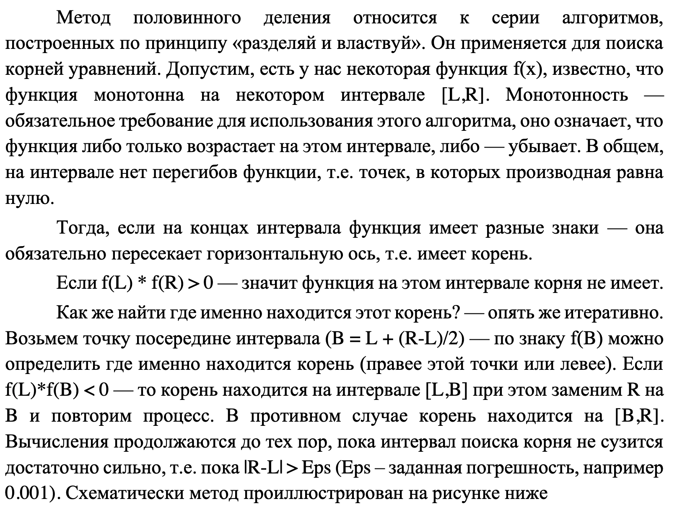

## 8. Решение уравнения методом касательных

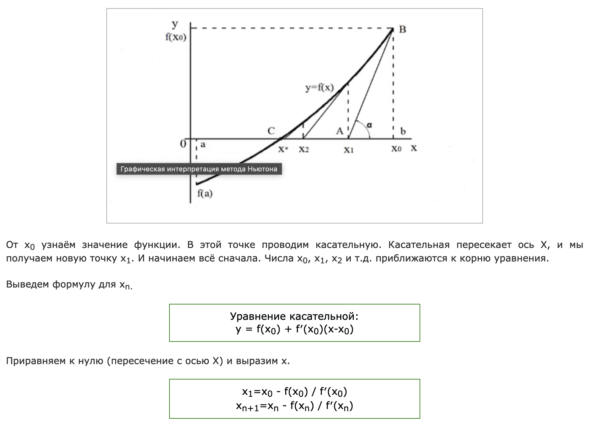

## 9. Решение уравнения методом хорд

Метод хорд — итерационный численный метод приближённого нахождения корня уравнения.

Половинное деление не учитывает никаких свойств функции F(x), а эта функция может нести в себе очень полезную информацию. Метод хорд предполагает следующее. От точек, ограничивающих кривую (заданные концы отрезка L и R), строится хорда, затем определяется точка её пересечения с осью абсцисс, точка пересечения становится новой границей отрезка, после чего строится новая хорда. Итерационный процесс задается следующей формулой:

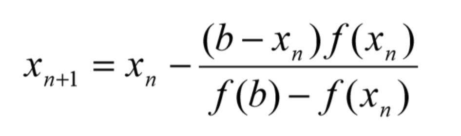

---

## 10. Метод наименьших квадратов. Регрессия

---

## 11. Алгоритм Евклида для поиска наибольшего общего делителя

Хорошее решение проблемы поиска наибольшего общего делителя двух чисел нашел еще Евклид. В самом простом случае алгоритм Евклида применяется к паре положительных целых чисел и формирует новую пару, которая состоит из меньшего числа и разницы между большим и меньшим числом. Процесс повторяется, пока числа не станут равными. Найденное число и есть наибольший общий делитель исходной пары. Блок-схема алгоритма выглядит следующим образом:

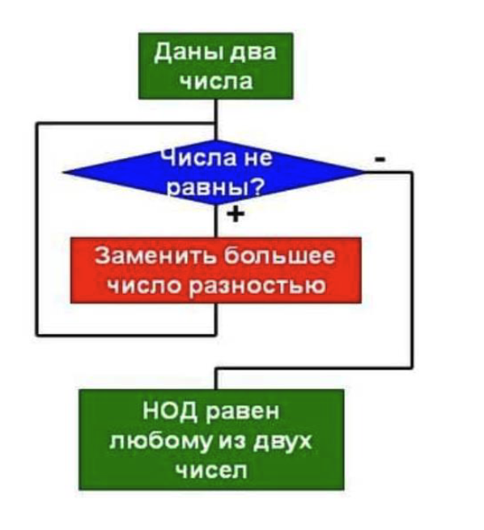

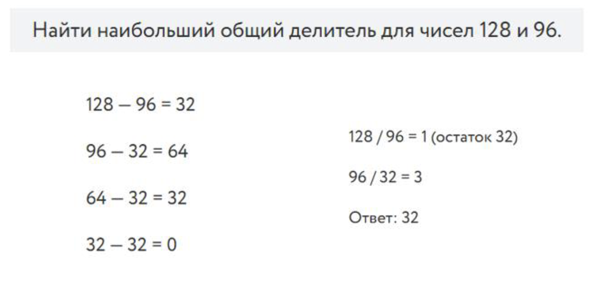

## 12. Понятие о факторизации числа

Факторизация числа — это процесс разложения числа на простые множители.

## 13. Алгоритм Ферма факторизации

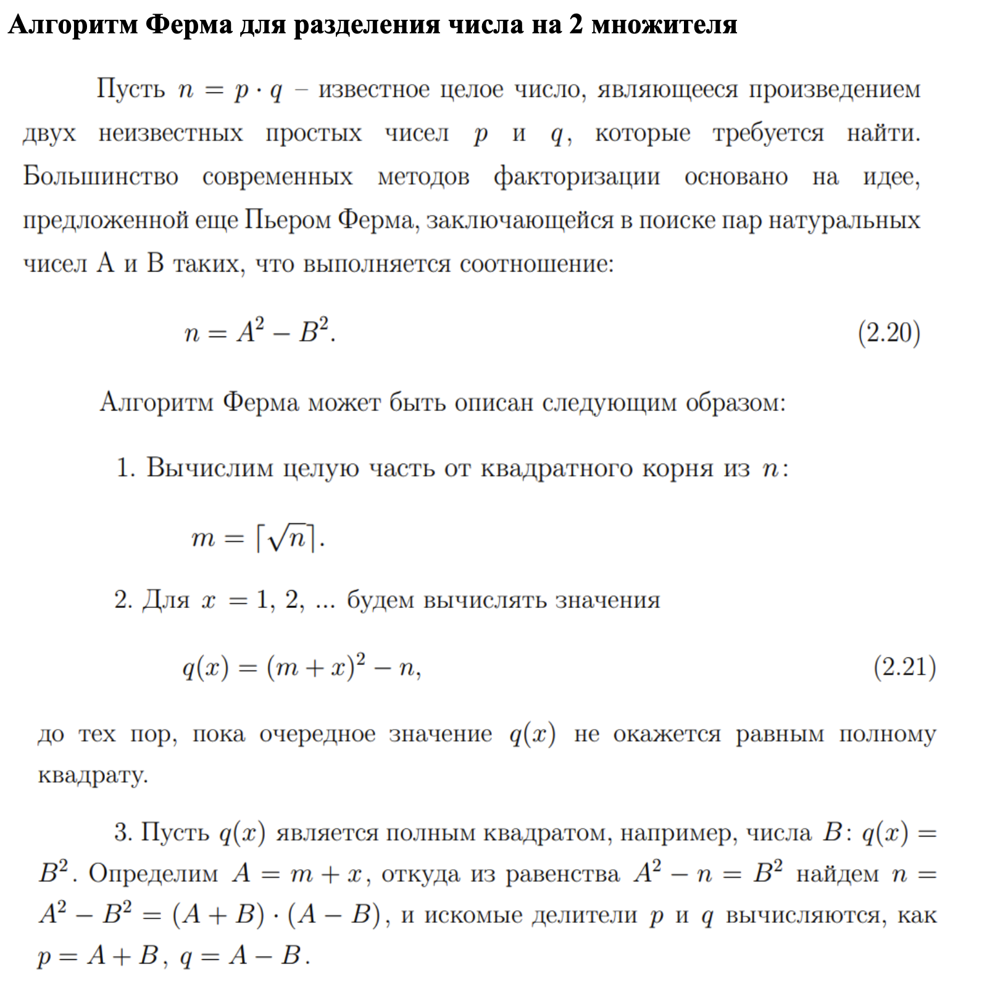

## 14. Алгоритмы поиска простых чисел. Решето Эратосфена

### Решето Эратосфена

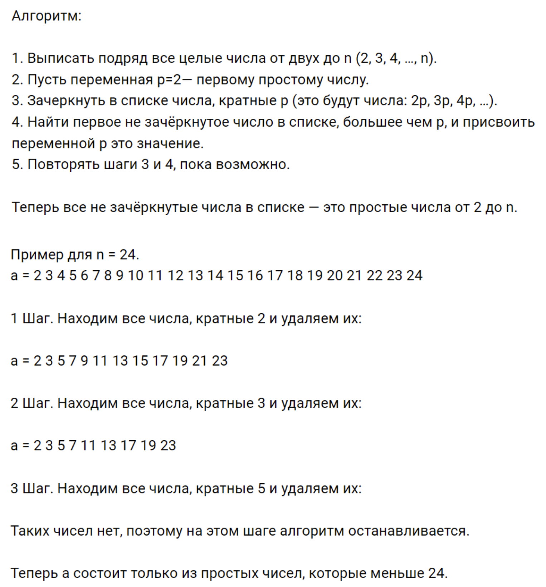

## 15. Числа Мерсенна. Тест Люка-Лемера

Число Мерсе́нна — число вида 2n-1, где n — натуральное число; такие числа примечательны тем, что некоторые из них являются простыми при больших значениях n. Названы в честь французского математика Маре́на Мерсенна, исследовавшего их свойства в XVII веке.

Для проверки числа Мерсенна на простоту существует простой тест Люка-Лемера. Это алгоритм, который предполагает на первом этапе построение последовательности по следующему правилу:

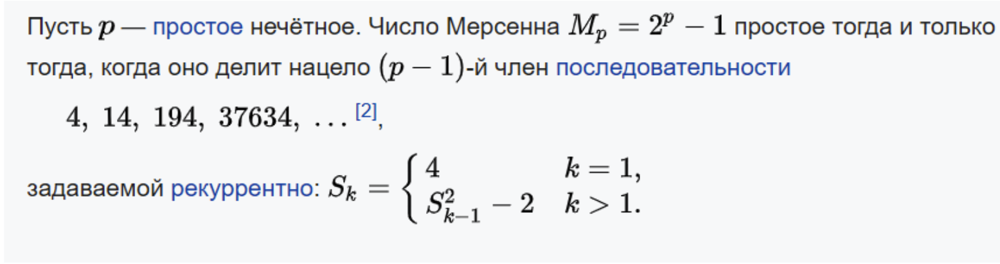

## 16. Псевдослучайные числа

В различных технических и математических приложениях часто необходим ряд случайных чисел. Числа называются случайными в силу того, что в их ряду нет никакой закономерности, зная некоторое количество последовательных чисел ряда, нельзя вычислить следующее.

Алгоритм фон Неймана для генерации псевдослучайных чисел состоит в следующем. Предположим, что некоторое случайное, достаточно большое число уже известно. Определить такое число совершенно не представляет проблему: так как оно первое, то оно может быть просто любым. Пусть, например, нас интересуют 5-значные случайные числа. Возьмем в качестве первого число 14 563. Возведем его в квадрат, получим 212 080 969. Возьмем из середины пять цифр 20 809. Это и будет следующее случайное число. Псевдослучайность получаемой последовательности очевидна. Каждое следующее число совершенно однозначно определяется предыдущим. Но нас это смущать не должно. Если неизвестно, как получены числа, то они выглядят вполне случайно. Но у метода есть более серьезный недостаток. Если последовательность продолжить, то может проявиться так называемый период. Периодом называется строго повторяющаяся последовательность чисел. Впрочем, для алгоритма фон Неймана можно подобрать исходное число, дающее период только после очень большого количества шагов.

## 17. Метод Карацубы для быстрого умножения двух чисел

Метод Карацубы — это алгоритм для быстрого умножения двух больших чисел, который основывается на принципе декомпозиции чисел на более мелкие части и рекурсивного использования умножения. Этот метод позволяет значительно уменьшить количество элементарных операций по сравнению с классическим методом умножения.

## 18. Алгоритм быстрого возведения в степень

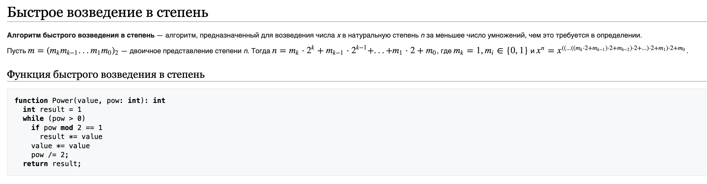

## 19. Понятие о рекурсии

Рекурсия — это такой способ организации вспомогательного алгоритма (подпрограммы), при котором эта подпрограмма (процедура или функция) в ходе выполнения ее операторов обращается сама к себе. То есть в теле функции она вызывает саму себя.

## 20. Числа Фибоначчи

Числа Фибоначчи — это последовательность чисел, где каждое следующее число равно сумме двух предыдущих. Обычно последовательность начинается с чисел 0 и 1.

## 21. Задача о Ханойской башне

Задача о Ханойской башне — это классическая головоломка, которая состоит в перемещении всех дисков с одного стержня на другой, используя третий стержень в качестве промежуточного, с условием, что на более крупный диск нельзя класть меньший.

## 22. Динамическое программирование

Динамическое программирование (DP) — это метод решения сложных задач путём разбиения их на более простые подзадачи и сохранения результатов этих подзадач для последующего использования.

### Основные принципы

1. **Разбиение задачи**: Исходная задача разбивается на несколько подзадач.
2. **Сохранение результатов**: Результаты каждой подзадачи сохраняются для последующего повторного использования.
3. **Комбинирование результатов**: Результаты подзадач комбинируются для получения решения исходной задачи.

## 23. Задача сортировки массива

Сортировка массива — это процесс упорядочивания элементов массива в определенном порядке, таком как по возрастанию или убыванию.

## 24. Алгоритм пузырьковой сортировки

Алгоритм состоит из повторяющихся проходов по сортируемому массиву. За каждый проход элементы последовательно сравниваются попарно и, если порядок в паре неверный, выполняется перестановка элементов. Проходы по массиву повторяются N-1 раз или до тех пор, пока на очередном проходе не окажется, что обмены больше не нужны, что означает — массив отсортирован. При каждом проходе алгоритма по внутреннему циклу очередной наибольший элемент массива ставится на своё место в конце массива рядом с предыдущим «наибольшим элементом», а наименьший элемент перемещается на одну позицию к началу массива («всплывает» до нужной позиции, как пузырёк в воде — отсюда и название алгоритма).

## 25. Алгоритм сортировки вставками

Алгоритм сортировки, в котором элементы входной последовательности просматриваются по одному, и каждый новый поступивший элемент размещается в подходящее место среди ранее упорядоченных элементов.

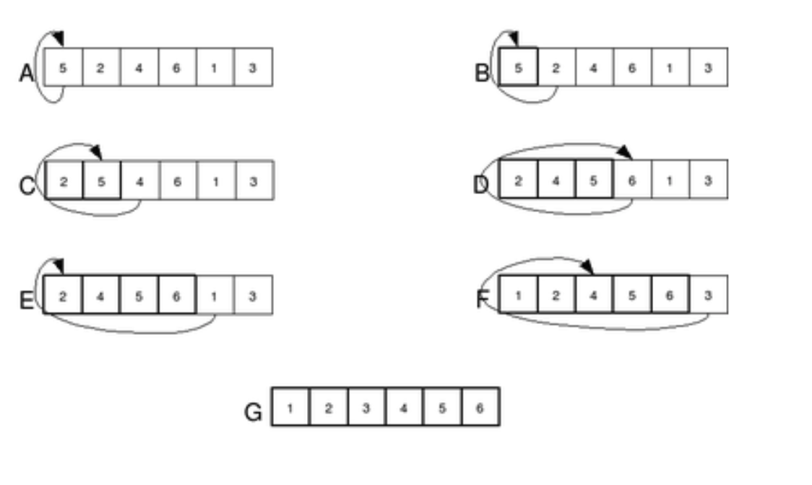

## 26. Алгоритм сортировки выбором

Шаги алгоритма:

1. находим номер минимального значения в текущем списке
2. производим обмен этого значения со значением первой неотсортированной позиции (обмен не нужен, если минимальный элемент уже находится на данной позиции)
3. теперь сортируем хвост списка, исключив из рассмотрения уже отсортированные элементы

## 27. Алгоритм шейкерной сортировки

Анализируя метод пузырьковой сортировки, можно отметить два обстоятельства. Во-первых, если при движении по части массива перестановки не происходят, то эта часть массива уже отсортирована и, следовательно, её можно исключить из рассмотрения. Во-вторых, при движении от конца массива к началу минимальный элемент «всплывает» на первую позицию, а максимальный элемент сдвигается только на одну позицию вправо. Эти две идеи приводят к следующим модификациям в методе пузырьковой сортировки. Границы рабочей части массива (то есть части массива, где происходит движение) устанавливаются в месте последнего обмена на каждой итерации. Массив просматривается поочередно справа налево и слева направо.

## 28. Алгоритм сортировки Шелла

Алгоритм сортировки, являющийся усовершенствованным вариантом сортировки вставками. Идея метода Шелла состоит в сравнении элементов, стоящих не только рядом, но и на определённом расстоянии друг от друга. Иными словами — это сортировка вставками с предварительными «грубыми» проходами. При сортировке Шелла сначала сравниваются и сортируются между собой значения, стоящие один от другого на некотором расстоянии d. После этого процедура повторяется для некоторых меньших значений d, а завершается сортировка Шелла упорядочиванием элементов при d=1 (то есть обычной сортировкой вставками). Эффективность сортировки Шелла в определённых случаях обеспечивается тем, что элементы «быстрее» встают на свои места (в простых методах сортировки, например, пузырьковой, каждая перестановка двух элементов уменьшает количество инверсий в списке максимум на 1, а при сортировке Шелла это число может быть больше)

## 29. Алгоритм быстрой сортировки

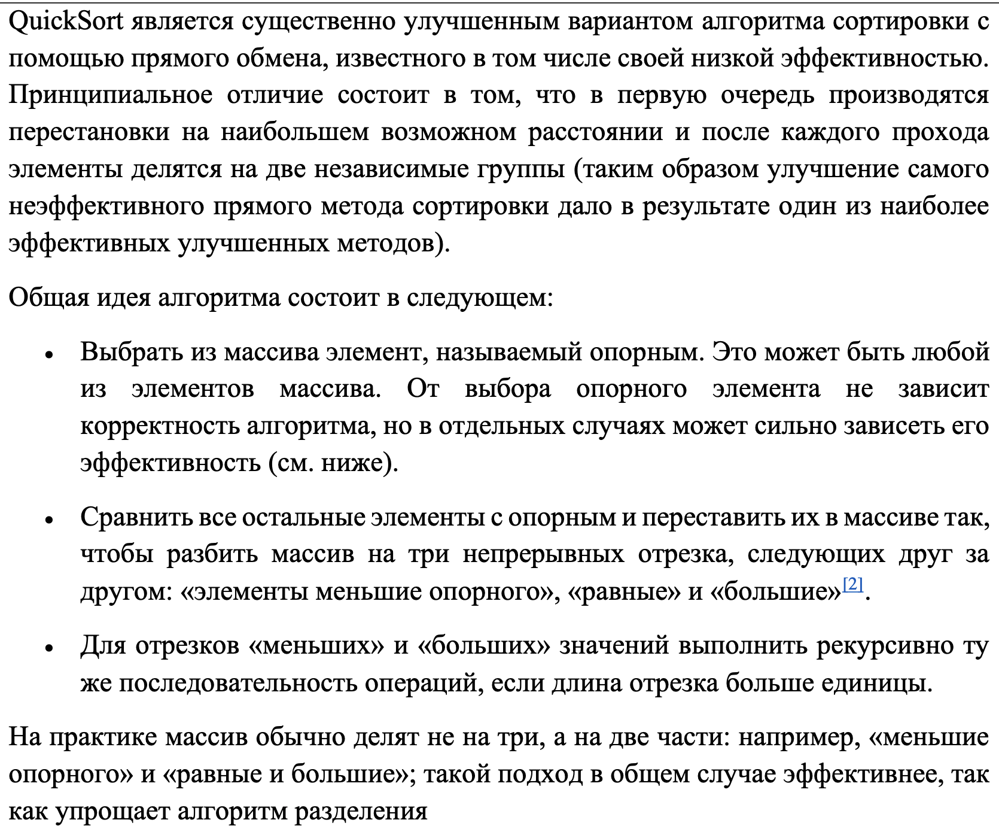

## 30. Алгоритм сортировки

Алгоритм сортировки — это алгоритм для упорядочивания элементов в массиве.

## 31. Основные структуры данных

Структура данных — это способ организации информации для более эффективного использования. В программировании структурой обычно называют набор данных, связанных определённым образом.

1. Массив (Array)
2. Динамический массив (Dynamic array)
3. Связный список (Linked list)
4. Стек (Stack)
5. Очередь (Queue)

## 32. Массив и динамический массив

### Массив

Одна из самых простых структур данных, которая встречается чаще всего. Именно на массивах основаны многие другие структуры данных: списки, стеки, очереди. Для простоты восприятия можно считать, что массив — это таблица. Каждый его элемент имеет индекс — «адрес», по которому этот элемент можно извлечь. В большинстве языков программирования индексы начинаются с нуля. То есть первый элемент массива имеет индекс не [1], а [0]. Данные в массиве можно просматривать, сортировать и изменять с помощью специальных операций.

Массивы бывают двух видов:

* **Одномерные.** У каждого элемента только один индекс. Можно представить это как строку с данными, где одного номера достаточно, чтобы чётко определить положение каждой переменной.
* **Многомерные.** У каждого элемента два или больше индексов. По сути, это комбинация из нескольких одномерных массивов, то есть вложенная структура.

Как применяют массивы:

* В качестве блоков для более сложных структур данных. Массивы предусмотрены в синтаксисе большинства языков программирования, и на их основе удобно строить другие структуры.
* Для хранения несложных данных небольших объёмов.
* Для сортировки данных.

### Динамический массив

В классическом массиве размер задан заранее — мы точно знаем, сколько в нём индексов. А динамический массив — это тот, у которого размер может изменяться. При его создании задаётся максимальная величина и количество заполненных элементов. При добавлении новых элементов они сначала заполняются до максимальной величины, а при превышении сразу создаётся новый массив, с большей максимальной величиной. Элементы в динамический массив можно добавлять без ограничений и куда угодно. Однако, если добавлять их в середину, остальные придётся сдвигать, что занимает много времени. Поэтому лучше всего динамический массив работает при добавлении элементов в конце.

Как применяют динамические массивы:

* В качестве блоков для структур данных
* Для хранения неопределённого количества элементов

## 33. Связный список

Ещё одна базовая структура данных, которую, как и массивы, используют для реализации других структур. Связный список — это группа из узлов. В каждом узле содержатся:

* Данные
* Указатель или ссылка на следующий узел
* В некоторых списках — ещё и ссылка на предыдущий узел

В итоге получается список, у которого есть чёткая последовательность элементов. При этом сами элементы более разрозненны, чем в массиве, поскольку хранятся отдельно. Быстро перемещаться между элементами списка помогают указатели.

Как применяют связные списки:

* Для построения более сложных структур данных
* Для реализации файловых систем
* Для формирования хэш-таблиц
* Для выделения памяти в динамических структурах данных

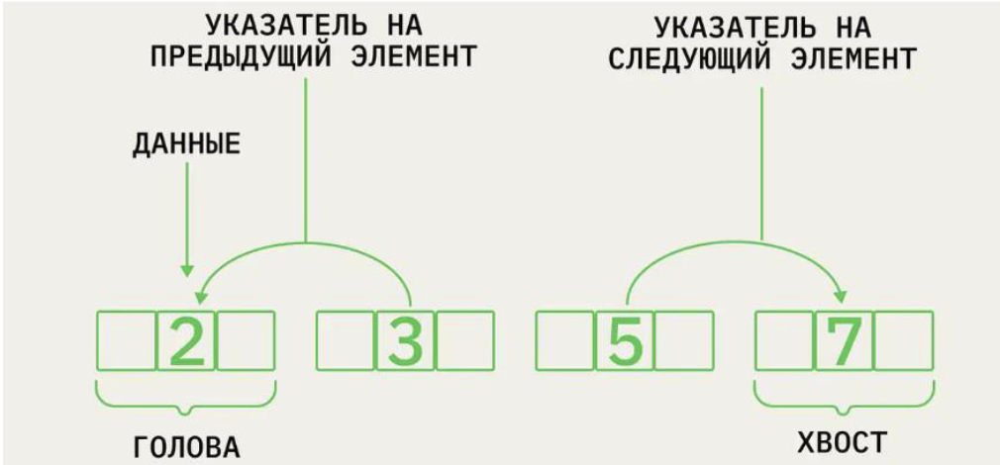

## 34. Стек

Эта структура данных позволяет добавлять и удалять элементы только из начала. Она работает по принципу LIFO — Last In, First Out (англ. «последним пришёл — первым ушёл»). Последний добавленный в стек элемент должен будет покинуть его раньше остальных.

Как применяют стеки:

* Для реализации рекурсии
* Для вычислений постфиксных значений
* Для временного хранения данных, например истории запросов или изменений

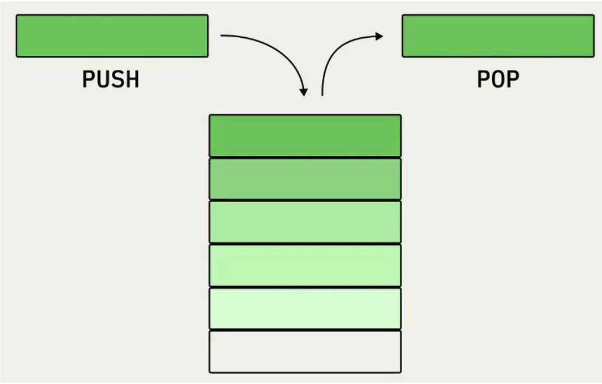

## 35. Очередь

Этот вид структуры представляет собой ряд данных, как и стек. Но в отличие от него она работает по принципу FIFO — First In, First Out (англ. «первым пришёл — первым ушёл»). Данные добавляют в конец, а извлекают из начала.

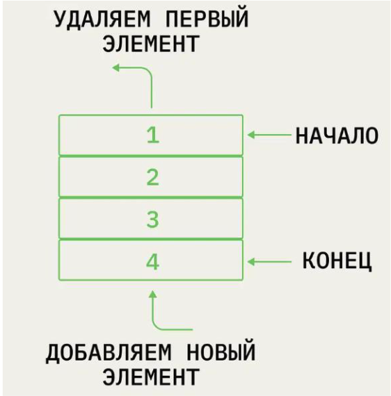

## 36. Множество

Множество в контексте структур данных представляет собой коллекцию элементов, где каждый элемент уникален (то есть в множестве не может быть повторяющихся элементов).

## 37. Карта

Карта - это структура данных, содержащая пары ключ-значение.

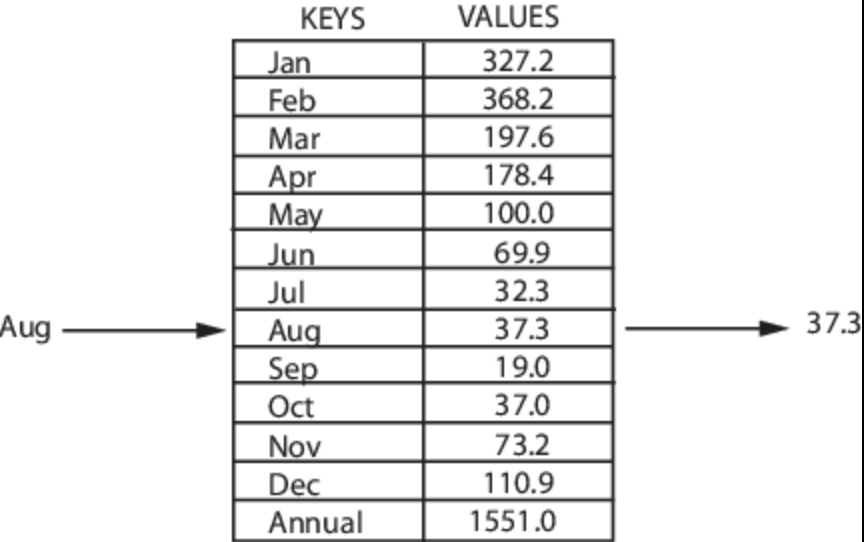

## 38. Двоичное дерево поиска

Двоичное дерево поиска (англ. binary search tree, BST) — двоичное дерево, для которого выполняются следующие дополнительные условия (свойства дерева поиска):

* оба поддерева — левое и правое — являются двоичными деревьями поиска;
* у всех узлов левого поддерева произвольного узла X значения ключей данных меньше либо равны, нежели значение ключа данных самого узла X;
* у всех узлов правого поддерева произвольного узла X значения ключей данных больше, нежели значение ключа данных самого узла X.

## 39. Префиксное дерево поиска

Trie или префиксное дерево — это особый вид дерева поиска, в котором для ключей узлов обычно используются строки.

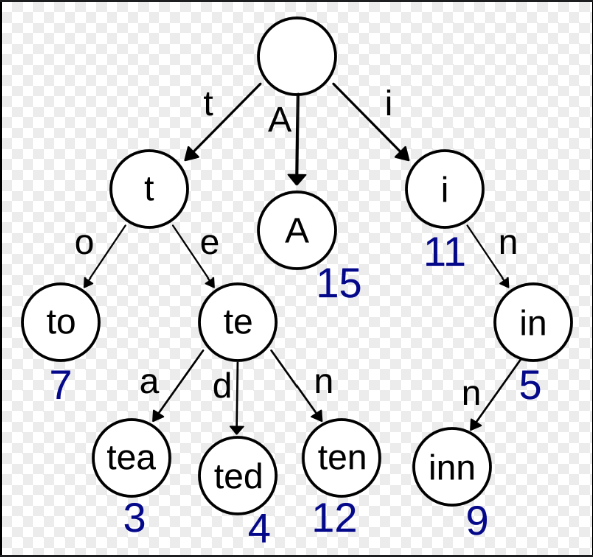

## 40. Сложность алгоритма. Сложность в среднем и худшем случае. O-нотация

Сложность алгоритма — это мера, которая описывает, как быстро возрастает время выполнения алгоритма по мере увеличения размера входных данных. Она может быть выражена с помощью O-нотации, указывающей верхнюю границу времени выполнения алгоритма в зависимости от размера входных данных.

### Примеры O-нотации

* **O(1)**: Константная сложность. Время выполнения алгоритма не зависит от размера входных данных. Пример: доступ к элементу в массиве по индексу.
* **O(log n)**: Логарифмическая сложность. Время выполнения алгоритма растёт логарифмически с ростом размера входных данных. Пример: бинарный поиск в отсортированном массиве.
* **O(n)**: Линейная сложность. Время выполнения алгоритма линейно зависит от размера входных данных. Пример: последовательный поиск в неотсортированном массиве.
* **O(n^2)**: Квадратичная сложность. Время выполнения алгоритма пропорционально квадрату размера входных данных. Пример: сортировка пузырьком.
* **O(2^n)**: Экспоненциальная сложность. Время выполнения алгоритма растёт экспоненциально с ростом размера входных данных. Пример: решение задачи коммивояжёра перебором всех возможных путей.

### Виды сложности

1. **В среднем случае (Average Case Complexity)**: Это оценка среднего времени выполнения алгоритма для всех возможных входных данных размера *n*. Сложность в среднем случае обычно используется в анализе случайных алгоритмов, где предполагается равновероятное возникновение всех возможных входов.
2. **В худшем случае (Worst Case Complexity)**: Это оценка максимального времени выполнения алгоритма для любого входного набора размера *n*. Сложность в худшем случае является наиболее пессимистичной оценкой времени выполнения, так как она определяет верхнюю границу времени выполнения алгоритма при наихудших условиях входных данных.

## 42. АВЛ-дерево

АВЛ-дерево — сбалансированное по высоте двоичное дерево поиска: для каждой его вершины высота её двух поддеревьев различается не более чем на 1

Для АВЛ-деревьев сбалансированность определяется разностью высот правого и левого поддеревьев любого узла. Если эта разность по модулю не превышает 1, то дерево считается сбалансированным. Данное условие проверяется после каждого добавления или удаления узла, и определен минимальный набор операций перестройки дерева, который приводит к восстановлению свойства сбалансированности, если оно оказалось нарушено.

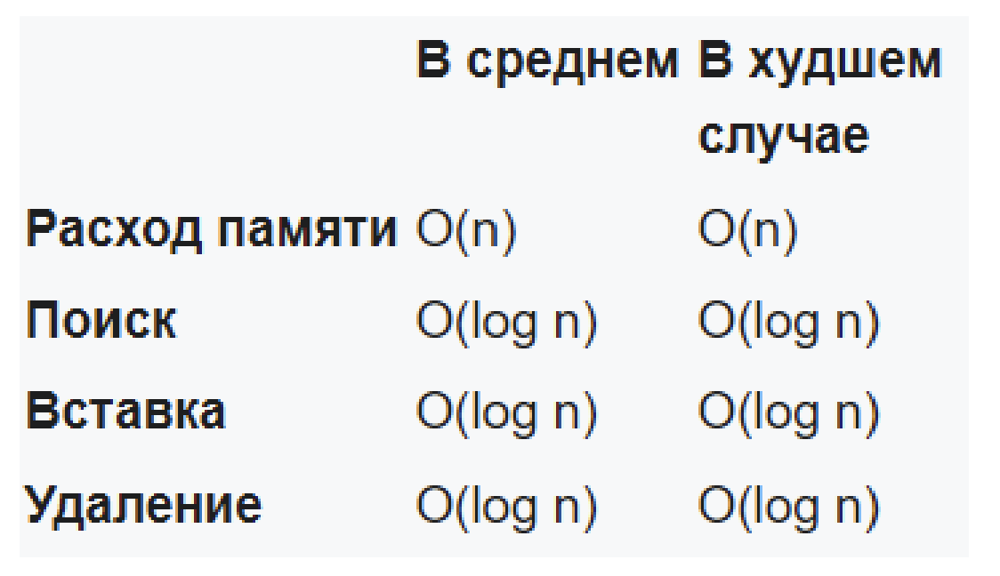

## 43. Красно-черное дерево

КЧ-деревья – это двоичные деревья поиска, каждый узел которых хранит дополнительное поле color, обозначающее цвет: красный или черный.

Свойства КЧ-деревьев:

1. каждый узел либо красный, либо черный;
2. каждый лист (фиктивный) – черный;
3. если узел красный, то оба его сына – черные;
4. все пути, идущие от корня к любому фиктивному листу, содержат одинаковое количество черных узлов;
5. корень – черный.

Черной высотой узла называется количество черных узлов на пути от этого узла к узлу, у которого оба сына – фиктивные листья. Черная высота дерева – черная высота его корня.

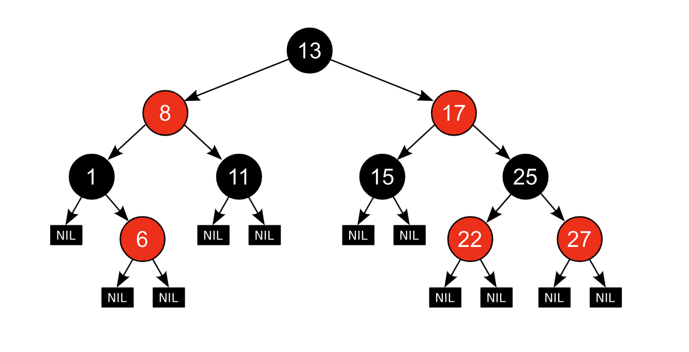

## 44. Splay-дерево

Самоперестраивающееся дерево – это двоичное дерево поиска, которое, в отличие от предыдущих двух видов деревьев не содержит дополнительных служебных полей в структуре данных (баланс, цвет и т.п.). Оно позволяет находить быстрее те данные, которые использовались недавно. Самоперестраивающееся дерево было придумано Робертом Тарьяном и Даниелем Слейтером в 1983 году.

Идея самоперестраивающихся деревьев основана на принципе перемещения найденного узла в корень дерева.

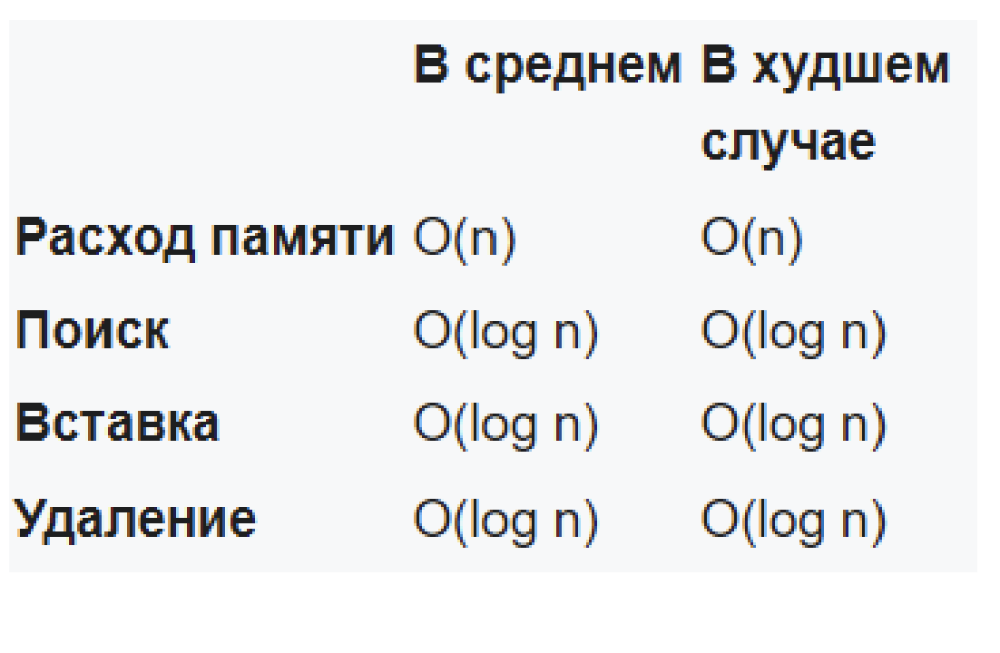

## 45. Двоичная куча

Куча (англ. heap) — это специализированная структура данных типа дерево, которая удовлетворяет свойству кучи: если B является узлом-потомком узла A, то ключ(A) ≥ ключ(B). Из этого следует, что элемент с наибольшим ключом всегда является корневым узлом кучи, поэтому иногда такие кучи называют max-кучами (в качестве альтернативы, если сравнение перевернуть, то наименьший элемент будет всегда корневым узлом, такие кучи называют min-кучами). Не существует никаких ограничений относительно того, сколько узлов-потомков имеет каждый узел кучи, хотя на практике их число обычно не более двух.

Двоичная куча — та, что создана с помощью двоичного дерева. Иногда ее называют пирамидой.

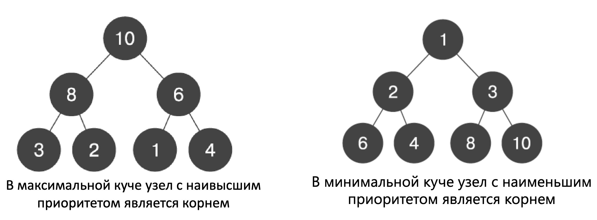

## 46. Хэш-таблица

Хеш-таблица — линейная структура данных, в которой хранятся пары «ключ — значение» с уникальными ключами.

## 47. Алгоритм шифрования Цезаря

Шифр Цезаря – это преобразование информации методом замены букв на другие, стоящие от данных через определенное количество символов в алфавите.

## 48. Блочные алгоритмы шифрования

Блочные алгоритмы шифрования представляют собой методы шифрования, которые оперируют не отдельными символами или битами, а блоками данных фиксированного размера. Эти алгоритмы широко используются для защиты данных в современных криптографических приложениях. Вот несколько основных блочных алгоритмов шифрования: AES, DES, ГОСТ 28147-89

## 49. Понятие о графе

Граф — это абстрактная математическая структура, которая представляет собой набор вершин (узлов) и рёбер (связей) между этими вершинами.

## 50. Алгоритм Прима

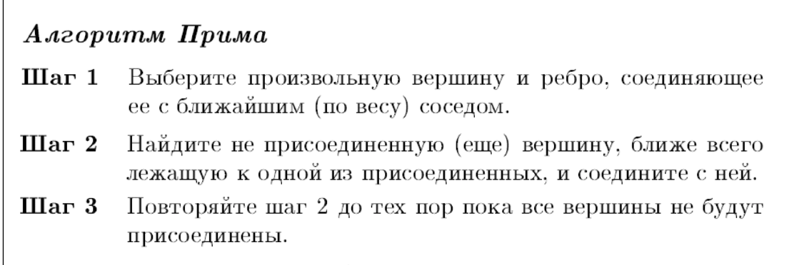

## 51. Число связности

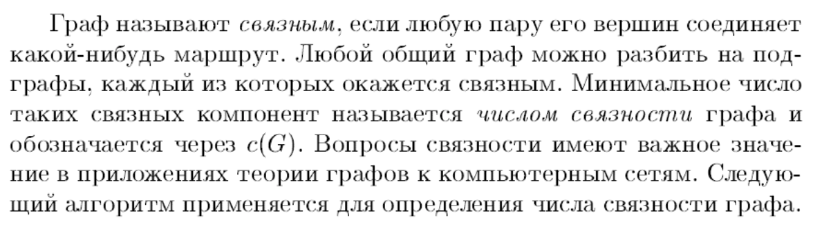

## 52. Матрицы смежности и инцидентности графа

## 53. Алгоритм ближайшего соседа

* **Выбор начальной вершины**: Выбирается начальная вершина
* **Поиск ближайшего соседа**: Текущая вершина соединяется с ближайшей ещё не посещённой вершиной. После выбора ближайшей вершины она помечается как посещённая и становится текущей.
* **Повторение**: Шаг 2 повторяются до тех пор, пока все вершины не будут посещены.
* **Возвращение в начальную вершину**: После посещения всех вершин, последняя выбранная вершина соединяется с начальной вершиной, завершая цикл.

## 54. Расширенный алгоритм Евклида

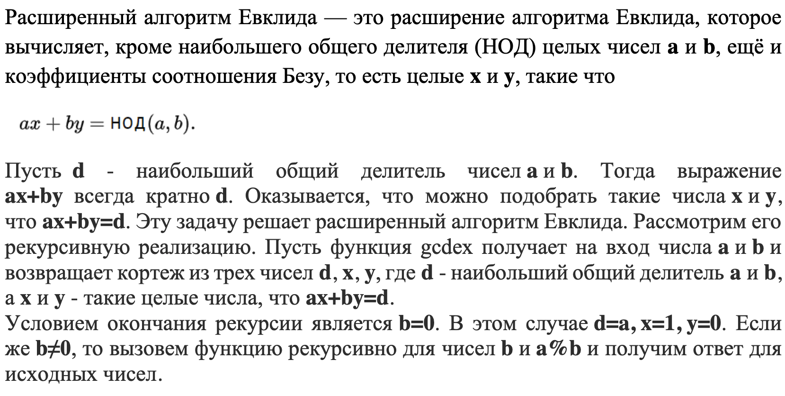

## 55. Шифрование с открытым ключом

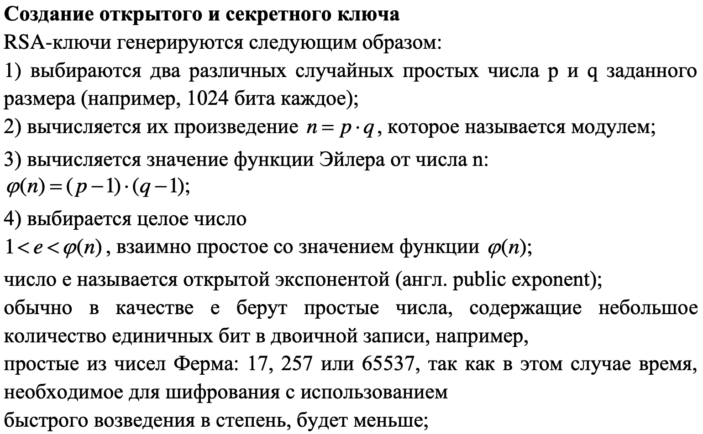
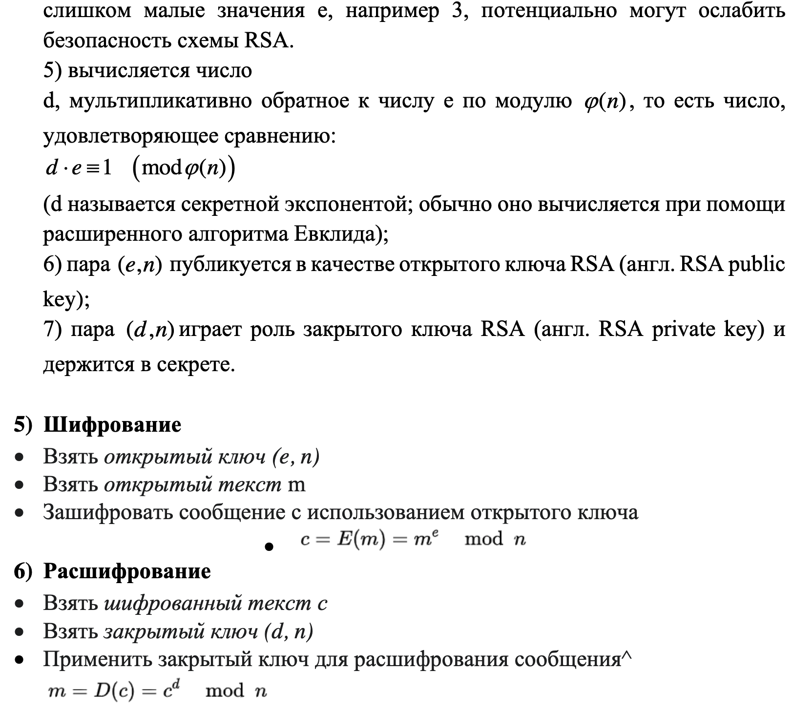

---

***With ❤️ by NKTKLN***
