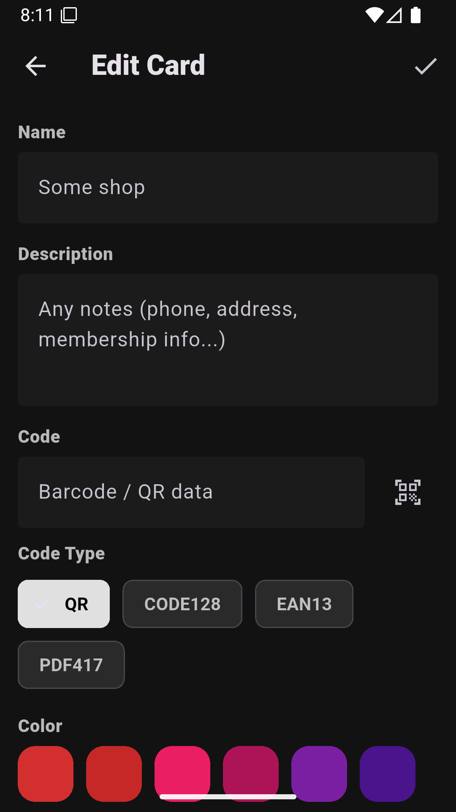
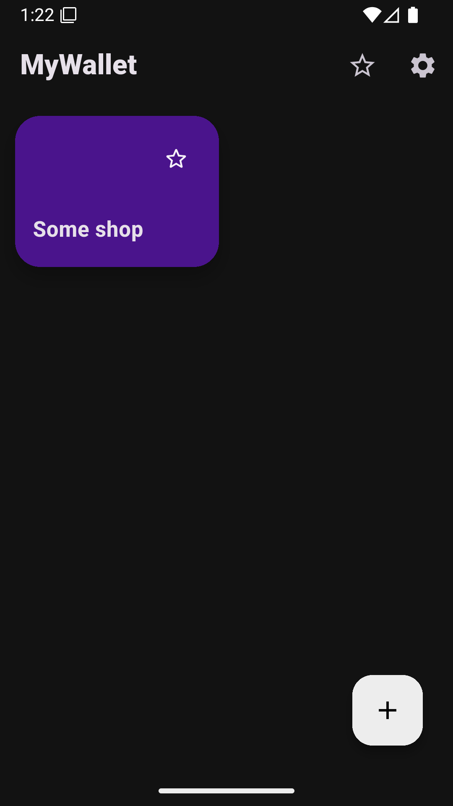
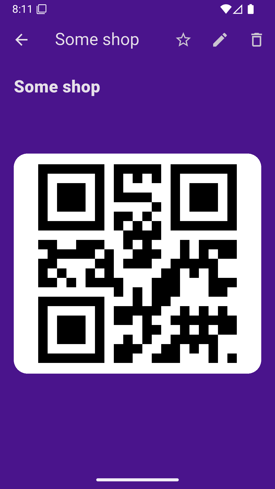
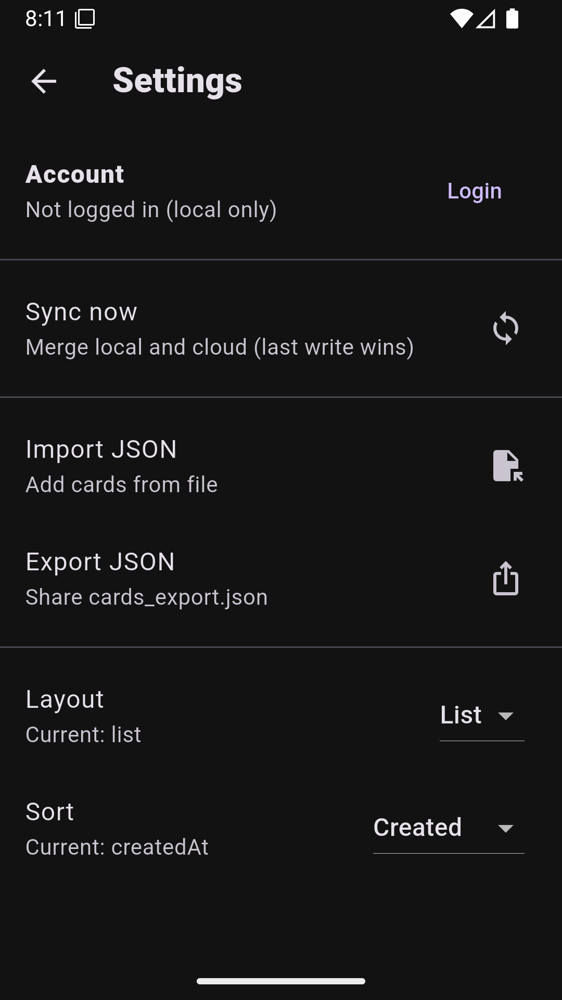

# **Анализ предметной области: Приложение для менеджмента дисконтных карт**

## ЭФБО-09-23 Калинин Никита

---

## 1. **Общая характеристика предметной области**

Современные пользователи ежедневно взаимодействуют с десятками торговых сетей, сервисов и компаний, предоставляющих скидки и программы лояльности. Большинство таких предложений оформляется через **физические дисконтные карты**, QR-коды, штрихкоды или цифровые идентификаторы. В результате у пользователей возникает проблема хранения большого количества карт и их оперативного использования.

Решением является **мобильное приложение**, позволяющее оцифровывать, хранить и организовывать дисконтные карты в удобной форме. Подобные приложения позволяют уменьшить количество физического пластика, ускорить обслуживание на кассе и обеспечивают быстрый доступ ко всем картам пользователя.

## 2. **Проблемы существующей системы**

В традиционной (неавтоматизированной) модели хранения дисконтных карт существуют следующие недостатки:

* **Физическое хранение**: карты занимают место в кошельке, легко теряются или повреждаются.
* **Сложности поиска** нужной карты — особенно если их десятки.
* **Отсутствие централизованного управления**: пользователь не имеет единой точки доступа к скидкам, акциям и деталям программ лояльности.
* **Неудобство при обслуживании**: поиск карты на кассе увеличивает время обслуживания.
* **Невозможность резервного копирования**: потеря физического кошелька может привести к потере всех карт.
* **Разрозненность приложений**: некоторые бренды создают свои приложения, но пользователь не хочет устанавливать десятки отдельных программ.

Эти проблемы создают спрос на универсальный инструмент хранения карт.

## 3. **Цели создания приложения**

Основные цели разработки приложения:

* **Обеспечить удобный электронный менеджмент дисконтных карт**.
* **Уменьшить необходимость в физических носителях**.
* **Ускорить процесс использования карты на кассе**.
* **Организовать карты по категориям, брендам, частоте использования**.
* **Создать единую пользовательскую платформу**, повышающую вовлечённость в программы лояльности.

## 4. **Основные участники предметной области**

| Участник                                              | Описание                                                                   |
| ----------------------------------------------------- | -------------------------------------------------------------------------- |
| **Пользователь**                                      | Владелец приложения, добавляет, редактирует и использует дисконтные карты. |
| **Торговые компании / сети**                          | Предоставляют данные о дисконтных программах, принимают штрихкоды/QR-коды. |
| **Кассовые системы**                                  | Сканируют цифровые карты с экрана.                                         |
| **Администратор системы**                             | Обеспечивает актуальность данных, обновления и безопасность.               |

## 5. **Объекты предметной области**

Основные информационные объекты, с которыми работает система:

* **Дисконтная карта** (тип, номер, штрихкод/QR, логотип компании).
* **Категория карты** (сети супермаркетов, одежда, аптеки и др.).
* **Профиль пользователя** (аккаунт, настройки).

## 6. **Функциональные требования**

### **Базовые функции**

* Сканирование карты и распознавание штрихкода/QR-кода.
* Ручной ввод номера карты.
* Хранение данных о картах в удобном списке.
* Категоризация и сортировка.
* Отображение карты в формате, пригодном для сканирования на кассе.
* Поиск по названию магазина или типу карты.

### **Дополнительные функции**

* Облачная синхронизация и резервное копирование.
* Виджет избранных карт.
* Импорт/экспорт карт.
* Автоматическое определение типа карты по штрихкоду.

## 7. **Нефункциональные требования**

* **Удобный UI/UX**, минимальные действия для добавления карты.
* **Безопасность данных** — защита личных номеров карт, шифрование.
* **Высокая скорость запуска приложения**.
* **Кроссплатформенность** (Android/iOS).
* **Возможность офлайн-работы** (использование карт без интернета).

## 8. **Анализ аналогов**

На рынке существуют приложения, частично реализующие похожие функции:

* **Stocard**
* **Google Wallet / Apple Wallet**
* **Кошелёк (Wallet)**

Их основные недостатки:

* Ограниченный набор форматов отображения карт.
* Навязчивые маркетинговые функции.
* Малый контроль над структурой и классификацией.
* Недостаточная локализация или поддержка локальных сетей.

Эти ограничения создают возможность для разработки более удобного, простого и локального решения.

## 9. **Вывод**

Предметная область характеризуется высокой актуальностью из-за широкого распространения дисконтных программ и необходимости централизованного хранения карт. Разработка приложения для менеджмента дисконтных карт позволяет устранить недостатки физического хранения, повысить удобство пользователя и создать единый инструмент для взаимодействия с программами лояльности.

Приложение должно обеспечивать быстрый доступ к картам, удобное добавление новых карт, безопасное хранение данных и расширенную функциональность (синхронизация, уведомления, категории).

Таким образом, анализ предметной области подтверждает необходимость создания современного мобильного инструмента для управления дисконтными картами.

# UseCase

# Скрины приложения

В приложении используются следующие библиотеки и инструменты:

- Firebase Cloud Firestore — применяется для хранения и синхронизации карт пользователя в облаке.
- Hive — лёгкая NoSQL база данных для локального хранения карт на устройстве и работы приложения в офлайн-режиме.
- Riverpod — библиотека управления состоянием приложения и разделения бизнес-логики и интерфейса.
- qr_code_scanner_plus — библиотека для сканирования QR-кодов и штрихкодов с помощью камеры устройства и отображением области сканирования.
- Path Provider — используется для получения путей к системным директориям устройства при импорте и экспорте файлов.
- UUID — применяется для генерации уникальных идентификаторов карт.
- Flutter Launcher Icons — используется для генерации иконки приложения под разные размеры экранов.
- Flutter Native Splash — применяется для создания нативного splash-экрана при запуске приложения.

Ссылка на Rustore: https://www.rustore.ru/catalog/app/com.nktkln.mywallet
