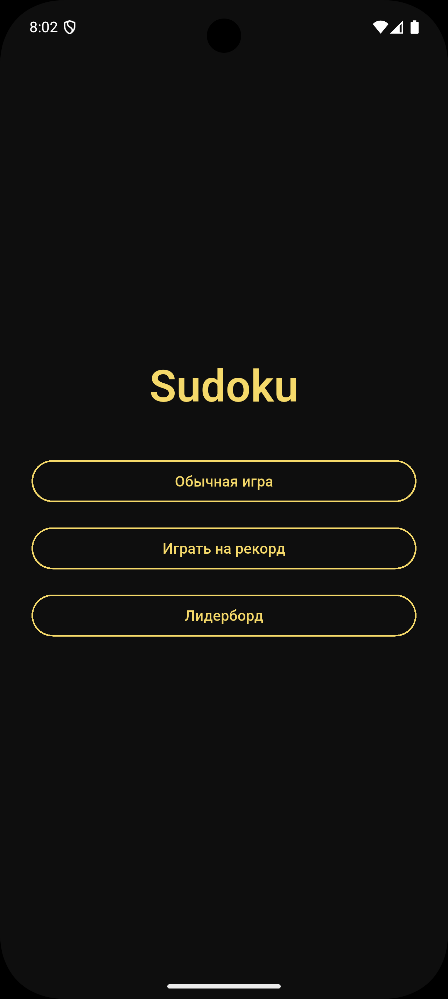
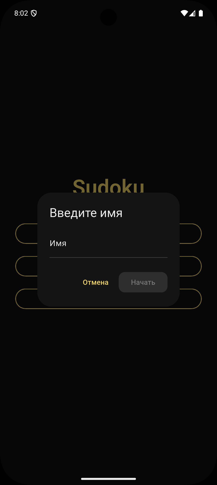
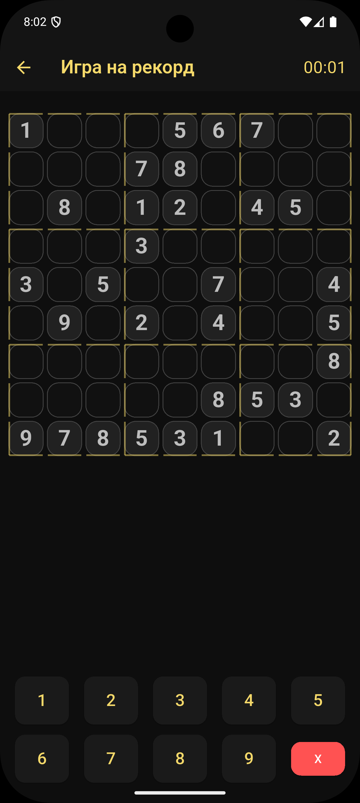
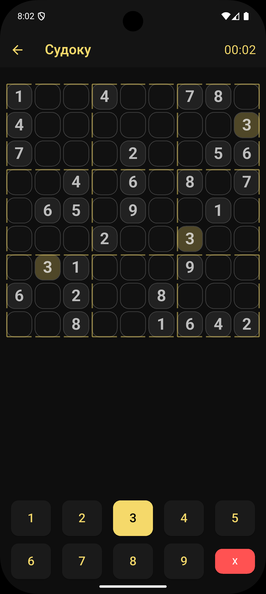
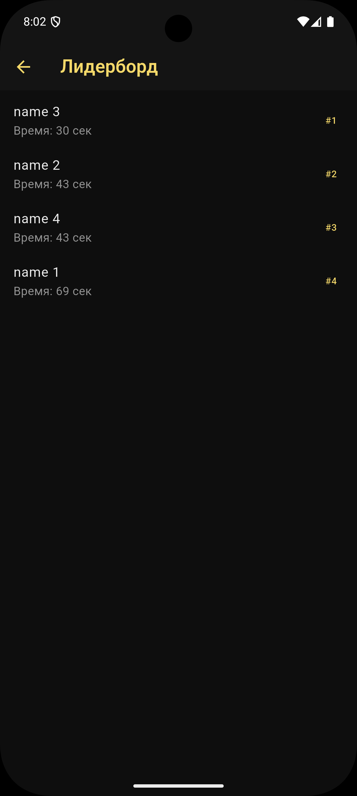

# Sudoku App — Руководство пользователя

Это руководство объясняет, как работать с мобильным приложением Sudoku App: разбор интерфейса, режимов игры, отправки результатов и просмотра лидерборда.

## 1. Главный экран (Home Page)

После запуска приложения отображается главный экран с тремя кнопками:

### Обычная игра

Запускает стандартный режим судоку без записи результатов. Подходит для спокойной игры и тренировки.

### Играть на рекорд

Запускает игру с таймером и последующей отправкой результата в онлайн-лидерборд.
Перед началом открывается диалог ввода имени:

* допускаются только буквы и пробелы;
* минимум 2 символа;
* ошибки подсвечиваются автоматически.

### Лидерборд

Показывает таблицу рекордов, загружаемую с сервера MockAPI.io.

## 2. Обычная игра

После выбора режима отображается игровое поле.

Элементы интерфейса:

### Игровая сетка 9×9

* Пустые клетки нужно заполнить.
* Исходные цифры (дано в задаче) отмечены тёмно-серым и недоступны для редактирования.
* Выбранная клетка выделяется цветом.
* Клетки с тем же числом подсвечиваются, чтобы облегчить поиск совпадений.

### Панель выбора цифр

Кнопки с числами от 1 до 9:

* Нажмите число — оно станет выбранным.
* Нажмите клетку — число вставится в неё.

Кнопка X:

* удаляет введённое число в выбранной клетке (если клетка не оригинальная).

## 3. Игра на рекорд

Особенности режима:

* Таймер запускается автоматически после генерации судоку.
* Текущее время выводится в правой части AppBar.
* После решения пазла появляется окно с итоговым временем.
* Результат автоматически отправляется на сервер и сохраняется в базе:

  * имя пользователя,
  * время,
  * сложность (Medium).

После отправки отображается окно победы и кнопка возврата.

## 4. Управление игровым полем

### Выбор клетки

Нажмите на любую свободную клетку — она подсветится.

### Ввод числа

Есть два способа:

1. выбрать число → нажать клетку;
2. нажать клетку → выбрать число.

Оба варианта вставляют цифру.

### Завершение игры

Игра считается решённой, когда все клетки заполнены и нет нулей.
В этот момент автоматически вызывается окно победы.

## 5. Лидерборд

Страница лидерборда отображает:

* имя игрока;
* время прохождения;
* порядковый номер результата (#1 — лучший);
* данные загружаются с сервера при каждом открытии экрана.

Сортировка выполняется по времени (от меньшего к большему).

## 6. Интерфейс и оформление

Приложение использует тёмную тему оформления:

* золотые акценты для интерактивных элементов;
* мягкие подсветки выбранных клеток;
* аккуратная сетка судоку, прорисованная через CustomPainter;
* толстые границы блоков 3×3.

Все элементы адаптируются под любые размеры экранов.

## 7. Работа приложения

### Генерация судоку

Пазл формируется в отдельном изоляте (compute), поэтому интерфейс не зависает.

### Обработка ошибок

Используются:

* runZonedGuarded,
* FlutterError.onError,
* собственный ErrorWidget (красное предупреждение).

### Валидация имени

Регулярное выражение разрешает только русские/латинские буквы и пробелы.

## 8. Скриншоты

### Главный экран

### Диалог ввода имени

### Игровое поле

### Лидерборд

## 9. Советы пользователю

* Для начала потренируйтесь в обычном режиме.
* Подсветка одинаковых чисел помогает быстрее находить комбинации.
* В режиме на рекорд время идёт постоянно — не делайте пауз.
* Проверка ошибок отключена: приложение не подсказывает, правильно ли вы поставили число.

## 10. Версия документа

User Guide, версия 1.0
Подходит для Sudoku App (Flutter)
