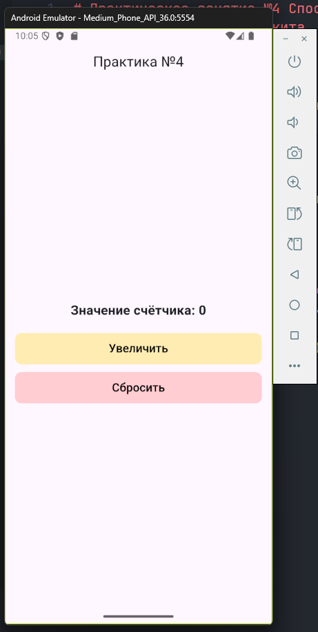
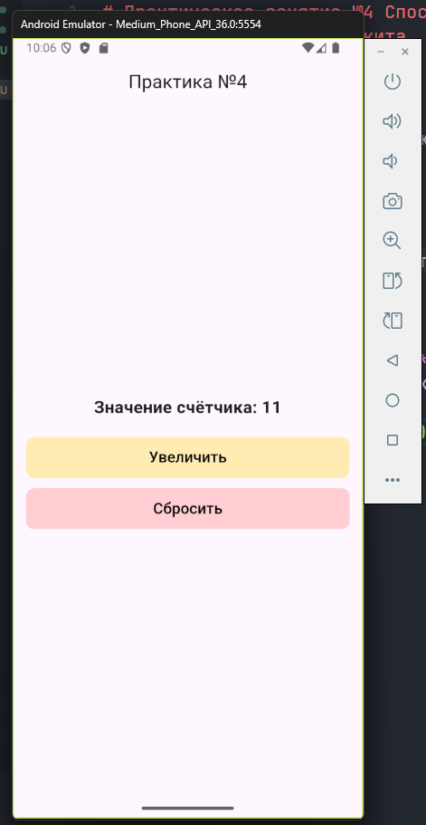
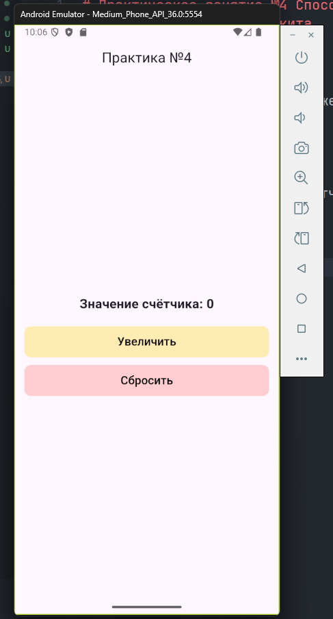

# Практическое занятие №4 Способы компоновки элементов и контейнеры. Обработка событий. Управление состоянием. Обновление состояния виджетов при нажатии кнопок или других событиях.

## ЭФБО-09-23 Калинин Никита

---

В приложении использовались виджеты Scaffold, Center, Column, Text, ElevatedButton и Container. Text стилизован с помощью размера шрифта, жирности и цвета. Кнопка оформлена с скруглёнными углами, цветом фона и текста, внутренними отступами. Контейнер имеет заданные размеры, цвет фона и центрированный текст.

1. Скриншот работающего приложения с кнопками и счётчиком.



2.	Скриншот при значении счётчика > 10.



3.	Скриншот после сброса.



---

Использованные виджеты:

* **MaterialApp** – корневой виджет приложения.
* **Scaffold** – базовая структура экрана с `AppBar` и `body`.
* **AppBar** – верхняя панель с заголовком «Практика №4».
* **Center** – Центрирование элементов.
* **Column** – вертикальное расположение элементов.
* **Text** – отображение текущего значения счётчика.
* **Container** – обёртка для кнопок, использована для изменения фона и скругления.
* **TextButton** – кнопки «Увеличить» и «Сбросить».
* **Padding** и **SizedBox** – для отступов между элементами.

---

**Реализация состояния:**

* Использован **StatefulWidget** (`CounterScreen`).
* Объявлена переменная состояния:

  ```dart
  int _counter = 0;
  ```
* Для обновления значения использовался метод **setState()**, который перерисовывает экран при изменении `_counter`.

Примеры:

```dart
setState(() {
  _counter++;
});
```

```dart
setState(() {
  _counter = 0;
});
```

```dart
setState(() {
  _counter += 10;
});
```

**Обработка событий:**

1. **onPressed** (обычное нажатие) – кнопка «Увеличить» увеличивает счётчик на 1.
2. **onLongPress** (долгое нажатие) – кнопка «Увеличить» увеличивает счётчик сразу на 10.
3. **onPressed** – кнопка «Сбросить» обнуляет счётчик.
