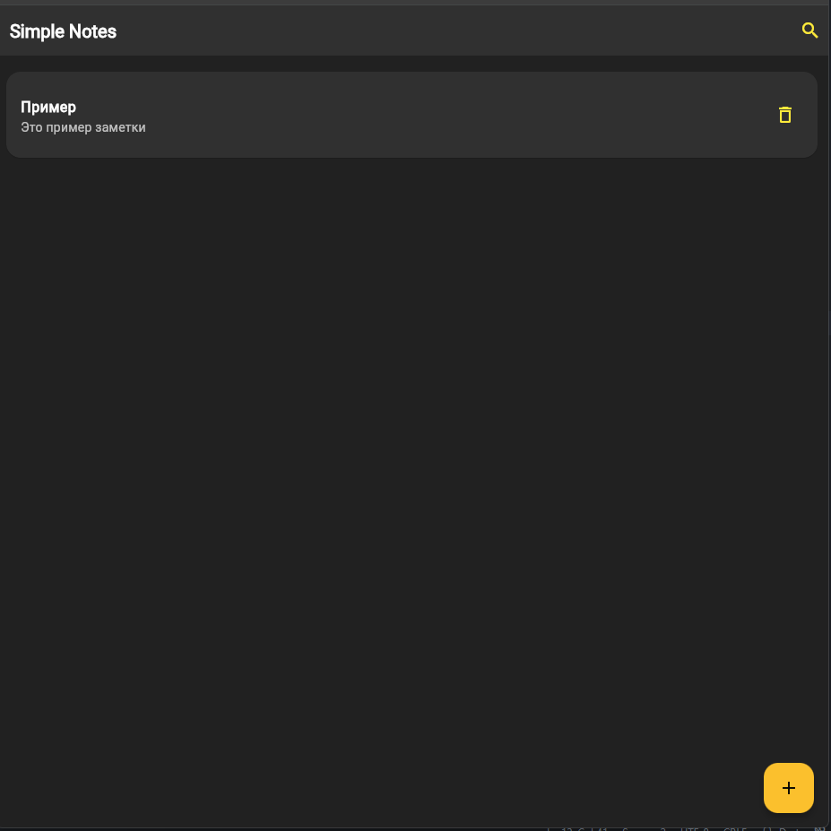
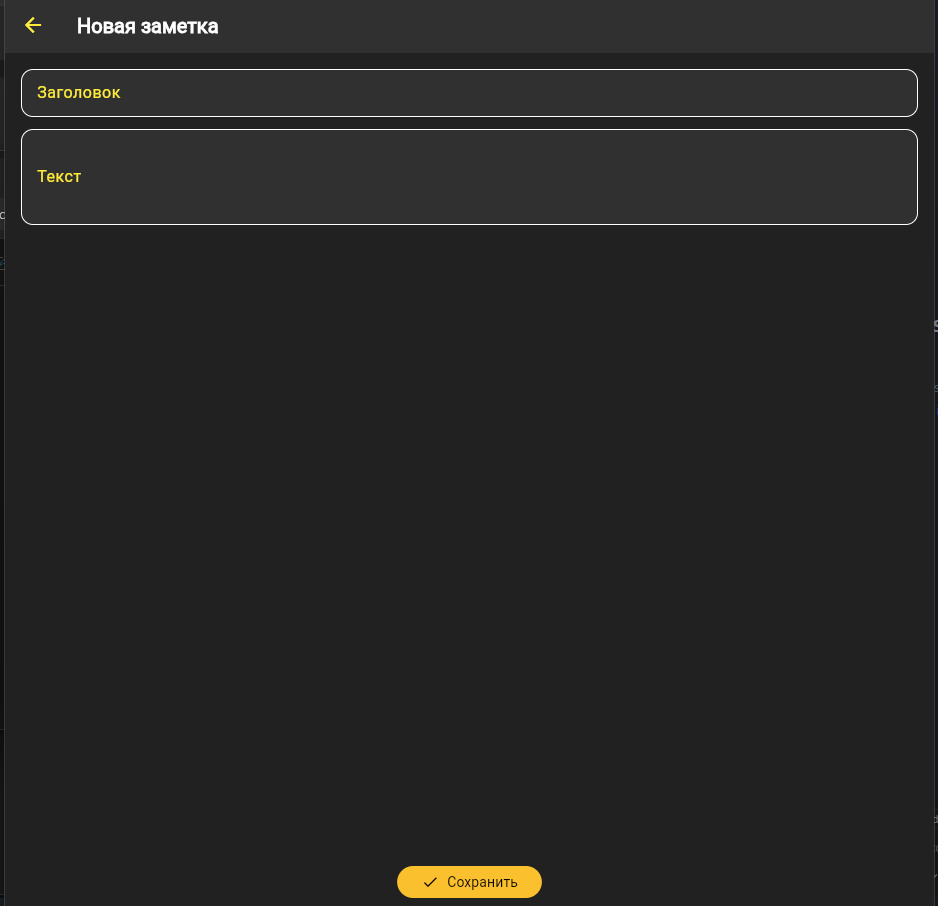
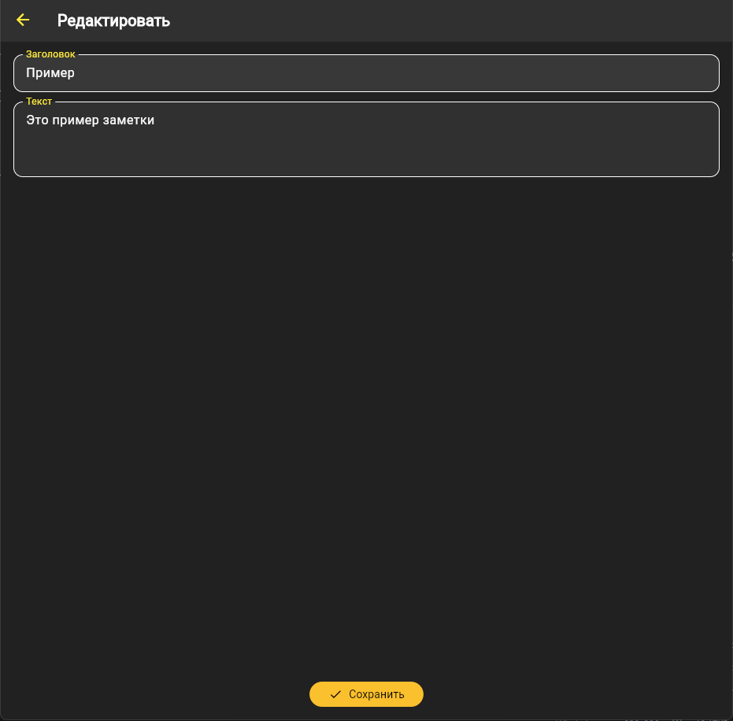
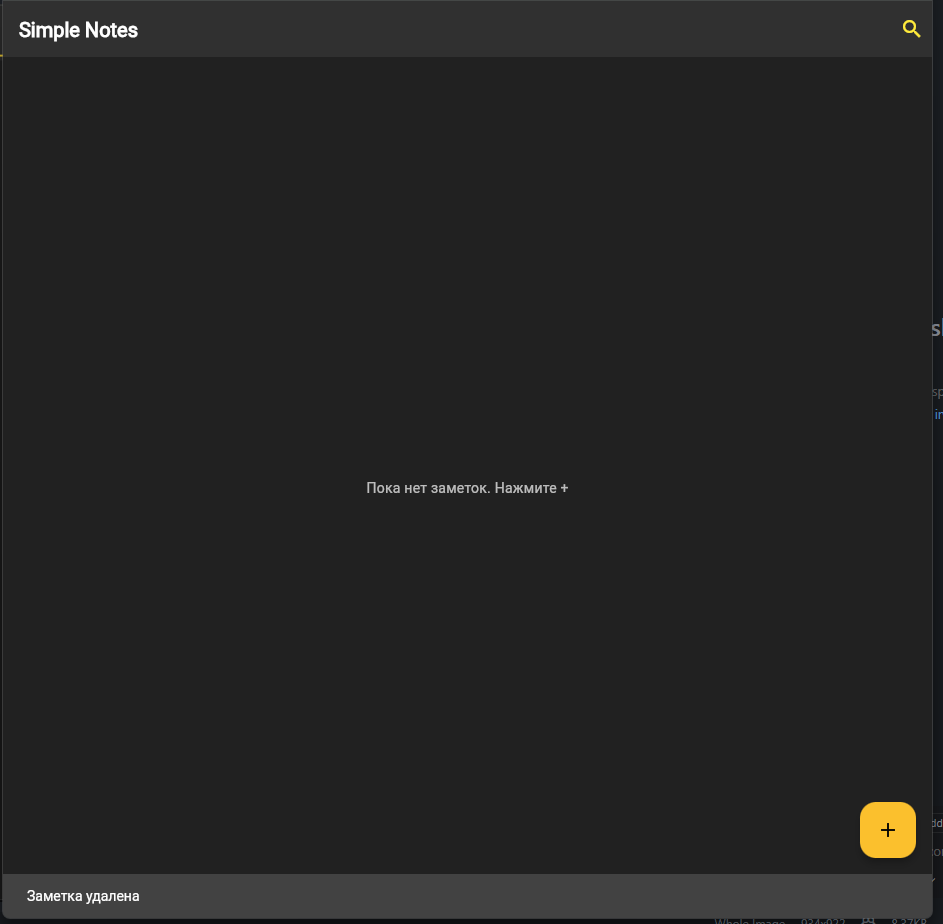
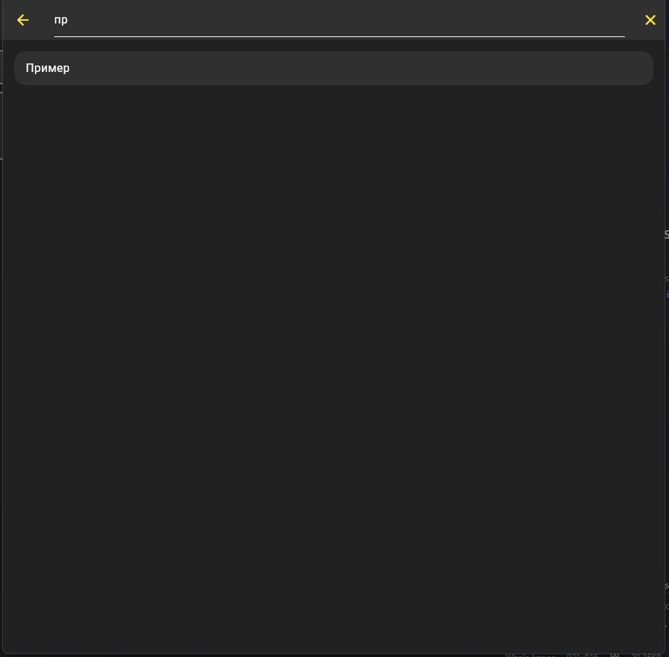
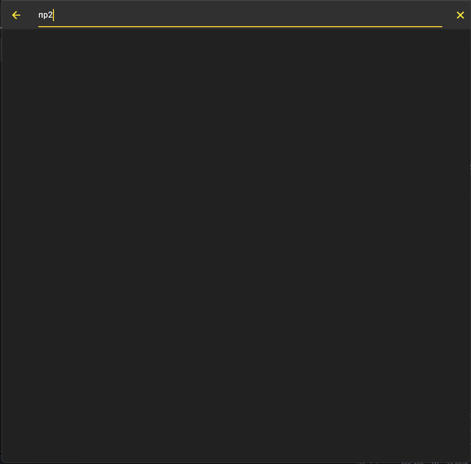

# Практическое занятие №5. Работа со списками. Передача данных между модулями

## ЭФБО-09-23 Калинин Никита

*Цели:*

- Научиться отображать коллекции данных с помощью ListView.builder.
- Освоить базовую навигацию Navigator.push / Navigator.pop и передачу данных через конструктор.
- Научиться добавлять, редактировать и удалять элементы списка без внешних пакетов и сложных архитектур.

---

## Ход работы

### Шаг 1. Определение модели данных

В файле `lib/models/note.dart` описал класс `Note`, который хранит данные заметки (id, заголовок, текст) и метод `copyWith` для удобного обновления.

**Фрагмент кода:**

```dart
class Note {
  final String id;
  String title;
  String body;

  Note({required this.id, required this.title, required this.body});

  Note copyWith({String? title, String? body}) => Note(
        id: id,
        title: title ?? this.title,
        body: body ?? this.body,
      );
}
```

### Шаг 2. Реализация главного экрана со списком

В `main.dart` создал экран `NotesPage`. Список заметок хранится в состоянии (`_notes`), а отображение реализовано через `ListView.builder`.
Каждая заметка представлена карточкой (`Card` + `ListTile`) с закруглениями, отступами и иконкой удаления.

**Фрагмент кода:**

```dart
body: ListView.builder(
  padding: const EdgeInsets.all(12),
  itemCount: _notes.length,
  itemBuilder: (context, i) {
    final note = _notes[i];
    return Card(
      color: Colors.grey[850],
      shape: RoundedRectangleBorder(
        borderRadius: BorderRadius.circular(16),
      ),
      child: ListTile(
        title: Text(note.title, style: const TextStyle(color: Colors.white)),
        subtitle: Text(note.body, style: const TextStyle(color: Colors.white70)),
        onTap: () => _edit(note),
        trailing: IconButton(
          icon: const Icon(Icons.delete_outline, color: Colors.yellow),
          onPressed: () => _delete(note),
        ),
      ),
    );
  },
),
```

### Шаг 3. Добавление и редактирование заметок

Создан отдельный экран `EditNotePage` (`edit_note_page.dart`) с формой (`Form` + `TextFormField`).

* Если заметка новая → генерируется уникальный id.
* Если заметка уже существует → применяется метод `copyWith`.

**Фрагмент кода:**

```dart
void _save() {
  if (!_formKey.currentState!.validate()) return;
  _formKey.currentState!.save();

  final result = (widget.existing == null)
      ? Note(
          id: DateTime.now().millisecondsSinceEpoch.toString(),
          title: _title,
          body: _body,
        )
      : widget.existing!.copyWith(title: _title, body: _body);

  Navigator.pop(context, result);
}
```

### Шаг 4. Удаление и свайп-удаление

Удаление реализовано двумя способами:

1. Кнопка с корзиной (`IconButton` в `trailing`).
2. Свайп по элементу через **Dismissible**.

**Фрагмент кода:**

```dart
Dismissible(
  key: ValueKey(note.id),
  direction: DismissDirection.endToStart,
  onDismissed: (_) => _delete(note),
  background: Container(
    color: Colors.red,
    alignment: Alignment.centerRight,
    padding: const EdgeInsets.symmetric(horizontal: 16),
    child: const Icon(Icons.delete, color: Colors.white),
  ),
  child: Card(...),
),
```

### Шаг 5. Реализация поиска

Для поиска добавлен `SearchDelegate`. Вызов через иконку 🔍 в AppBar.
Фильтрация выполняется по заголовку заметки.

**Фрагмент кода:**

```dart
final filtered = _notes
    .where((n) => n.title.toLowerCase().contains(_search.toLowerCase()))
    .toList();
```

---

1. Скриншот списока задач.



2.	Скриншот страницы создания задачи.



3.	Скриншот страницы редактирования задачи.



4.	Скриншот после удаления задачи.



4.	Скриншоты страницы поиска задач.




